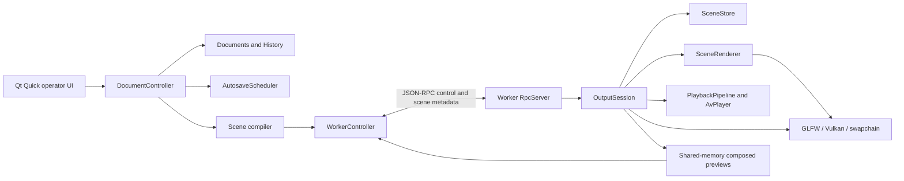

# Architecture and implementation audit

Audited 2026-10-29 against `1b54bdb` plus the SceneStore sharing change described
below. This is a source audit of completed tasks, with current test results in
[PROGRESS.md](../PROGRESS.md). [PLAN.md](../PLAN.md) defines the intended design;
the [M6 review](M6-code-review.md) records the original findings, whose source
line numbers and descriptions are historical.

## Ownership and dependencies

These boxes are responsibilities, not all separate classes. Preview production
and background transport still live inside OutputSession; RPC, preview consumption
and supervision still share WorkerController. Their extraction is pending.

| Boundary | Implementation and evidence | Assessment |
|---|---|---|
| Editable documents and history | `src/domain/{documents,history,storage}.cpp`; Qt adapters in `src/ui/DocumentController.cpp`; `domain_tests`, `document_controller_tests` | Matches. The frontend owns editable state and package writes; history has one observed Documents and bounded snapshots. |
| Immutable render scenes | `src/scene/{scene,demo}.cpp`, `scene_tests` | Matches. Compilation resolves styles, geometry, item order and asset paths; the worker validates scene JSON. The scene library currently depends on domain types/compiler code, but neither uses Qt or GPU APIs. |
| Process separation | `src/worker/CMakeLists.txt`, `worker_is_qt_free`, headless preset | Matches. GLFW/Vulkan/Skia/FFmpeg/PipeWire stay in the worker. Qt Quick, process supervision and document adapters stay in the frontend. |
| RPC | `src/protocol`, `src/worker/rpc/{RpcServer.cpp,OutboundQueue.h}`, `src/ui/WorkerController.cpp`; protocol/limits/transport/controller tests | Matches the bounded metadata transport. Worker socket writes are nonblocking; preparation inside dispatch can still block the RPC loop. |
| Requested versus presented state | `src/worker/session/SceneStore.{h,cpp}`, `scene_store_tests`, `output_status_tests` | Matches. Decide captures commands together; landed state is distinct from published state. OutputSession reports the store's published state after successful presentation. |
| Composition and text | `src/worker/render/{SceneRenderer,SceneText,Layer}.{h,cpp}`; scene/frame/Unicode/pixel tests | Matches the shared worker text renderer, public Skia/ICU integration and direct audience composition. Layer-control semantics have the discrepancy below. |
| Video and audio ownership | `src/worker/{media,playback}`, `src/worker/render/YuvGpu.cpp`; GPU/decode/queue/control/mix/sync tests | Matches bounded queues, displayed-image leases, generation checks and independent audio controls. Transport lifecycle still blocks the render thread during changes. |
| Previews | `src/worker/preview/PreviewStream.cpp`, OutputSession preview methods, WorkerController consumer; ownership/selection/budget tests | Matches shared memory and exact stream/sequence release. Output and audience mirror use the same captured frame; edit selection and thumbnails deliberately render separate scenes. Readback is synchronous. |
| Persistence | `src/domain/storage.cpp`, `src/ui/AutosaveScheduler.cpp`; domain/controller tests | Matches durable staged package writes, asset adoption and coalesced background autosave. Explicit save/load and decision waits remain synchronous. |
| Demo isolation and dependencies | `render/TestScene.cpp`, `cmake/OpenShowSkia.cmake`, `scripts/build-skia.sh`; production/pixel/public-API guards | Production starts black and uses SceneRenderer without a demo builder. Demo/diagnostic drivers still link into the worker executable. Skia is a pinned submodule with public application includes and compatible ICU. |

## Open differences from the plan

These do not reopen every historical milestone. They limit what its DONE status
proves and must be closed or explicitly accepted before M6/M7 acceptance.

| Difference observed in source | Consequence | Follow-up |
|---|---|---|
| `RpcServer::handle()` calls `OutputSession::prepareScene()` synchronously; `preloadScene()` decodes stills and probes media on that thread. | Slow storage can delay status, clear, releases and shutdown. Bounded socket writes alone do not make dispatch responsive. | **6.9a**, still TODO despite later completed tasks. |
| Scene apply starts/stops transports on the render loop; `SceneItemsLayer::layoutFor()` shapes on cache miss during draw. `drawSceneBackground()` calls `SceneImageCache::backdropFor()`, which builds a missing blur backdrop synchronously. | Cold go, audio pre-roll, teardown and the first blur draw can miss frame deadlines. The historical statement that the first blur build is outside the frame loop is incorrect; only the cache mutex is released. | **6.9b** must include text and blur prewarming alongside media readiness. |
| Production `ImageLayer::draw()` returns when a scene is active. `SceneItemsLayer` draws both text and foreground images in authored order under `LayerId::kWords`. | The `images` toggle does not hide authored images; `words` hides both. Splitting the item stack by type would also change overlap order. | **6.20** must resolve mixed-item ordering versus independent image/word controls with explicit behavior and regression coverage. This audit preserves current pixels. |
| `DocumentController::save()` waits for autosave quiescence and calls `saveServiceAndAdopt()` inline; load and quit also drain synchronously. | 6.14b proves background **autosave**, not that all persistence is off the UI thread. | **6.19b** save coordination; **6.20** records remaining responsiveness limits. |
| Preview rendering/readback runs on the render thread after output; its budget defers future attempts after an overrun. | It bounds average preview work and drops owned slots, but cannot prevent one expensive readback delaying the next audience frame. | **6.18a2** preserves the policy; **6.9b/7.2/7.4** measure worst-frame impact. |
| SceneImageCache retains pinned resources even above its 192 MiB eviction budget. | The budget bounds evictable decoded data, not total process/GPU memory; pinned excess is reported. | **7.2/7.4** resource accounting and service soak. Do not describe it as a hard total-memory cap. |
| Missing foreground image errors are logged in `preloadScene()`; the acknowledged media error lane remains background/transport focused. | A missing foreground box can disappear without an operator-facing per-item error. | **6.20** failure-reporting closure (R18); keep a focused task if further implementation is needed. |
| PreviewProducer files/tests exist untracked, but neither worker CMake nor OutputSession uses that class. Other extraction targets remain combined. | The planned responsibility boundaries are partly implemented. File presence does not satisfy an extraction. | **6.18a2**, **6.18b**, **6.19a/b**. |
| Stable display identity, destination-removal disabling and complete restart/device recovery are not complete. | Historical display tests and successful launch/shutdown do not establish M7 failure recovery. | **7.1a–c**, physical Wayland/X11 and projector acceptance. |

## Contracts to retain during optimization

- `SceneStore` owns prepared IDs and desired/landed/published output state.
  Prepared scenes are immutable shared instances; a pin survives store eviction.
  The session acquires its mutex before the store mutex, never the reverse.
- `SceneFrame` captures one audience moment. Drawing another target does not
  advance a transition or publish a revision. Publication means successful
  submission/presentation to the window system, not proof of physical scanout.
- The audience composition pass creates no per-layer/intermediate render
  target or `saveLayer`. Preview/snapshot targets and cached CPU blur data are
  separate resources, not extra audience composition layers. Source guards
  supplement pixel tests; they are not a timing proof.
- RPC has a 1 MiB encoded JSON payload limit in both directions, a bounded
  outbound queue and 64 frontend in-flight requests. Original assets, decoded
  media and audio buffers never travel in RPC. Composed preview pixels use
  shared memory; ready/release messages carry metadata.
- The live preview transport uses three slots, normally 640×360 at up to
  15 fps when content changes; never overwrite an unreleased slot. Selected
  scenes and thumbnail batches have their own bounded requests and identity.
- Native audio decoding feeds bounded rings; the mixer feeds one PipeWire
  stream per AvPlayer. Background-video and standalone transports have
  independent lifetimes, so production can own two AvPlayers/streams. This
  differs from the original single-stream wording: **6.20** must explicitly
  accept that design or restore a shared output mixer. PipeWire callbacks must
  not perform file/RPC/preview work.

## Optimization made during this audit

SceneStore previously stored Scene values, copied one at each `pin()`, and
maintained a separate copy/cache for frame capture. It now copies once on
prepare, outside its lock, and stores `shared_ptr<const Scene>`. Pins, iteration
and frame snapshots use that same instance. This removes repeated deep copies
and the capture cache, and allows selected previews of the same prepared
revision to hit the renderer's pointer-keyed layout cache. Separate prepared
revisions remain separate instances even when their values are equal.

`scene_store_tests` checks shared identity across repeated pins and capture,
isolation from later edits to the caller's Scene, and survival after eviction.
Existing publication, cap, transition and concurrent-command checks remain.
No performance percentage is claimed without a benchmark.
