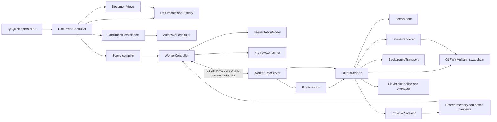

# Architecture and implementation audit

Audited 2026-10-29 against `1b54bdb` plus the SceneStore sharing change and the
6.18a2 `PreviewProducer` extraction described below. This is a source audit of
completed tasks, with current test results in
[PROGRESS.md](../PROGRESS.md). [PLAN.md](../PLAN.md) defines the intended design;
the [M6 review](M6-code-review.md) records the original findings, whose source
line numbers and descriptions are historical.

## Ownership and dependencies

These boxes are responsibilities, not all separate classes. Preview production
graduated into `PreviewProducer` (task 6.18a2) and the background media into
`BackgroundTransport` (task 6.18b1), both beside `SceneStore`, task 6.18b2 moved
the bench/diagnostic drivers into their own `openshow-worker-dev` executable,
task 6.19a1 moved the frontend's transport into `RpcClient`: the socket, the
framing, the reply ledger, the send bounds and the write-stall deadline, task
6.19a2 moved the frontend's pictures into `PreviewConsumer`: the shm mapping and
the mirror, off-air and thumbnail frames copied out of it, task 6.19a3 moved
the acknowledged output model into `PresentationModel`: the revision mirror, the
latest-go rule, the clear derivation and the restore snapshot, and task 6.19a4
split the worker side the same way — `RpcServer` is the connection (accept,
framed read, hello gate, bounded queue and deadline, drain, shutdown) and
`RpcMethods` is the meaning of a request (the method table and the
status/notification encoders). What shares `WorkerController` now is the process
supervisor and its QML facade, which is the division the plan intends; the
planned split 6.19b1–b8 — the `DocumentPersistence` and
`DocumentViews` adapters out of `DocumentController`, then `Main.qml`'s shortcut
map, output panel, playlist panel, show page, edit page and settings page —
has now fully landed. **6.19b1**: `DocumentPersistence`
(`src/ui/DocumentPersistence.{h,cpp}`, `openshow-ui-core`) owns the scratch, its
executor, the decision protocol around an explicit save or load and the wording
of a refusal or a survivor, and `DocumentController` keeps the documents, their
history and what a decision does to them. **6.19b2**: `DocumentViews` (same
target) shapes the rows the views read — songs, a song's slides and their
backgrounds, the current slide's boxes, styles and the resolved style,
playlists with each entry's show resolved, the media registry, the drawer's
search, and the selected box's text, kind and asset — and is a pure reader with
no state of its own: where a shape depends on where the operator is, the
navigation arrives as a `Cursor` value the controller builds from the ids it
owns, and `selectedBox()` is the single resolution of the selection with its
positional fallback that the controller's own box-scoped edits go through
too. **6.19b3**: `ShortcutMap` (`src/ui/ShortcutMap.qml`) holds the window's
entire key table — 49 `Shortcut`s whose gates the component composes itself
from fact properties passed in (page, focus holders, canvas selection, on-air
state, settings opt-in) and whose activations leave as intent signals the
window handles — because two enabled `Shortcut`s for one key make Qt drop the
key, so R17's one-live-owner-per-key rule is only checkable where every
claimant is on one page. **6.19b4**: `OutputPanel`
(`src/ui/OutputPanel.qml`) is the right dock — the preview and every output
tool below it — mirroring `worker` status and dragging through `panels` on
its own; the window keeps only the anchors and the id the centre pages use,
and the 4.4 inline panel primitives became shared module files so extracted
panels carry the look without borrowing a window declaration. **6.19b5**:
`PlaylistPanel` (`src/ui/PlaylistPanel.qml`) is the left dock — playlist
chips, the running order with its reorder handles, row drag and nearest-gap
drop target, and the dirty-marked status line — every gesture addressing the
controller directly, so the window again keeps only placement and the id.
**6.19b6**: `ShowPage` (`src/ui/ShowPage.qml`) is the centre's show page —
slide list with its worker-drawn band, history and navigation rows, picture
panel and lyric editor — and it owns follow mode outright (nothing outside
the block ever read it), so its one window contract is `presentRequested()`:
presenting is the only act the keyboard executors share. **6.19b7**:
`EditPage` (`src/ui/EditPage.qml`) is the centre's edit page — the canvas
stage, the debounced worker picture of the slide under edit, the geometry
fields, the stack commands and the style panel — and because only the canvas
tracks the live rectangle a nudge commits from, the key map's nudge and step
executors live on the page and its `boxSelected` alias, the flag the two
Escape owners hand off on. **6.19b8**: `SettingsPage`
(`src/ui/SettingsPage.qml`) is the settings page — the two persisted toggles,
the fifteen-row cheat sheet and the service rows — and it and `ShortcutMap`
now name each other: the map is where a key changes, the sheet is the promise
the operator was given. That closes 6.19b; `Main.qml` is composition —
placement, the page gate, the focus facts and the executors — at 255 lines.

| Boundary | Implementation and evidence | Assessment |
|---|---|---|
| Editable documents and history | `src/domain/{documents,history,storage}.cpp`; the Qt session adapter in `src/ui/DocumentController.cpp` with durability in `src/ui/DocumentPersistence.cpp` and the view rows in `src/ui/DocumentViews.cpp`; `domain_tests`, `document_controller_tests` | Matches. The frontend owns editable state and package writes; history has one observed Documents and bounded snapshots; since **6.19b1** exactly one class decides when either is written to disk, and since **6.19b2** exactly one place spells what a list row shows. |
| Immutable render scenes | `src/scene/{scene,demo}.cpp`, `scene_tests` | Matches. Compilation resolves styles, geometry, item order and asset paths; the worker validates scene JSON. The scene library currently depends on domain types/compiler code, but neither uses Qt or GPU APIs. |
| Process separation | `src/worker/CMakeLists.txt`, `worker_is_qt_free`, headless preset | Matches. GLFW/Vulkan/Skia/FFmpeg/PipeWire stay in the worker. Qt Quick, process supervision and document adapters stay in the frontend. |
| RPC | `src/protocol`, `src/worker/rpc/{RpcServer.cpp,RpcMethods.cpp,OutboundQueue.h}`, `src/ui/{RpcClient,WorkerController,PreviewConsumer,PresentationModel}.cpp`; protocol/limits/transport/controller tests; prepare-time file work in `session/PrepareExecutor.{h,cpp}` | Matches the bounded metadata transport. Since **6.19a1** the frontend half has its own class: `RpcClient` owns the socket, the framing, the ledger of requests the worker owes, the size/backlog/in-flight refusals and the 2 s no-byte deadline, and interprets no result — a reply returns with its request's method name, connection generation and the caller's intent record, which is R3's rule kept in one place (`WorkerController::onRpcReply` decides meaning). Since **6.19a3** the scene operations the facade sends are decided by `PresentationModel`, which holds no transport of its own and reaches the ledger only through the injected callbacks. Since **6.19a4** the worker half is split the same way: `RpcServer` is the connection (accept, framed read, hello gate, bounded queue and progress-measured write deadline, drain, deferred-answer bag, shutdown) and `RpcMethods` is the method table and the status/notification encoders, answering through an injected sink so the prepare executor never learns a socket exists; only the connection can end a session. Worker socket writes are nonblocking; since 6.9a dispatch schedules still decodes and media probes onto the bounded prepare executor and answers each request from its completion (self-piped wake, ids correlate), so a cold file delays no other command. |
| Media transport | `src/worker/session/BackgroundTransport.{h,cpp}` over `playback/{PlaybackPipeline,AvPlayer}`; `background_transport_tests` plus the live `background_media_tests` | Matches since **6.18b1** (2026-10-29). The transport owns the background pipeline and its feeder, the standalone track and its swap, the video seam's two bounded slots and their leases, the newest-wins intent slots, the typed faults and the media status mirror; R6's quiesce boundary and the render-thread-owns-the-transport rule are stated in its header. Since **6.9b** (2026-10-30) it also owns the one primed background: `primeVideo` opens a prepared clip's file half on the prepare executor and parks it as the single prime, the render thread attaches that prime's GPU half at the frame boundary (or opens cold), and a superseded prime is closed on the thread that made it. The session keeps the loop's wake gate and the frame's present/lease calls, delegates the RPC verbs, and reads the mirror in `status()`. |

| Requested versus presented state | `src/worker/session/SceneStore.{h,cpp}`, `scene_store_tests`, `output_status_tests` | Matches. Decide captures commands together; landed state is distinct from published state. OutputSession reports the store's published state after successful presentation. |
| Composition and text | `src/worker/render/{SceneRenderer,SceneText,Layer}.{h,cpp}`; scene/frame/Unicode/pixel tests | Matches the shared worker text renderer, public Skia/ICU integration and direct audience composition. Since **6.9b** the layout cache belongs to each `SceneRenderer` — a companion borrows the engine's fonts and shaping, never the audience's four slots, its LRU clock or its miss counter (R16) — and a prepare shapes into the production renderer's own cache. Layer-control semantics have the discrepancy below. |
| Video and audio ownership | `src/worker/{media,playback}`, `src/worker/render/YuvGpu.cpp`; GPU/decode/queue/control/mix/sync tests | Matches bounded queues, displayed-image leases, generation checks and independent audio controls. Since **6.9b** a prepared clip's demux/decode half opens on the prepare executor (`PlaybackPipeline::openFile`) and the render thread's part is the Ganesh attach (`attachGpu`); a clip nobody primed still opens wholly on the render loop. |
| Previews | `src/worker/session/PreviewProducer.{h,cpp}` over `src/worker/preview/PreviewStream.cpp`; the consumer is `src/ui/PreviewConsumer.{h,cpp}` (task 6.19a2), read through `WorkerController`; `preview_producer_tests` plus ownership/selection/budget tests | Matches. The producer owns the stream lifecycle, target arbitration, generation gates, thumbnail queue and budget policy; the session hands in frames and wakes the loop. The consumer owns the mapping, its own two ask generations, the asked/wanted dedupe, the byte-bounded thumbnail LRU and the stand-down re-issues, and asks only through the transport its host injects. Shared memory with exact stream/sequence release; output and audience mirror use the same captured frame; edit selection and thumbnails deliberately render separate scenes. Readback is synchronous. |
| Persistence | `src/domain/storage.cpp`, `src/ui/{AutosaveScheduler,DocumentPersistence}.cpp`; domain/controller tests | Matches durable staged package writes, asset adoption and coalesced background autosave. Since **6.19b1** the coordination has one owner: `DocumentPersistence` runs the decision protocol (quiesce, write or discard, remove the scratch the decision made stale with its survivor reported, reopen), the deferred refusal surfacing that keeps the crash net, the 2.3 startup rule and the quit-edge durable wait. Explicit save/load and decision waits remain synchronous. |
| Demo isolation and dependencies | `render/TestScene.cpp`, `cmake/OpenShowSkia.cmake`, `scripts/build-skia.sh`; production/pixel/public-API guards | Production starts black and uses SceneRenderer without a demo builder. Since 6.18b2 the demo scene and the diagnostic drivers compile only into `openshow-worker-dev`; the product binary cannot reach them. Skia is a pinned submodule with public application includes and compatible ICU. |

## Review closure: R1–R19 evidence matrix (task 6.20a)

The review's completion rule says every finding must have passing regression
evidence or an explicit M7 gate, and that "the new behavioural regressions
pass". This matrix is that accounting. A row is evidenced when its named
fixtures exist in the ctest inventory of the stated preset and pass its
recorded gate; the current green run is the one recorded for this leaf in
[PROGRESS.md](PROGRESS.md), whose desktop run covers all 53 tests including
all 12 display-labelled ones, and whose headless run covers all 32 — every
fixture named below passed in it. Preset marks: **H** runs in the headless
inventory (and therefore in both), **D** is desktop-build only without a
display label, **D✦** is desktop-build and display-labelled. Where M6
deliberately left work, the row carries the explicit M7 reference from the
review's own mapping; where this matrix found a finding bare, it records it
bare. The matrix reports; it does not paper.

| Finding | Closed by | Fixtures pinning it | Open remainder |
|---|---|---|---|
| **R1** production output used the development scene | 6.1a–b; 6.18a1, 6.18b2 | `production_output_tests` (D✦: fresh `--socket` worker reads black, uniform including the footer region), `render_production_compositor` (H), `render_scene_snapshot`/`render_layer_composition`/`render_scene_transition` (H), `worker_is_qt_free`/`worker_check_deps` (H) with `openshow-worker-dev` carrying the demo/bench drivers | none |
| **R2** repeated audio starts and standalone-only playback failed | 6.7a–b; transport state in 6.18b1 | `audio_mix_tests` (H: restartable mixer, stable source identities, sinkless clock semantics), `av_sync_tests` (H: audio→audio, silent→audio, failure→retry), `background_media_tests` (D✦: live transport restarts) | the contract's one-software-mixed-stream wording vs the two shipped transports — **6.20d** |
| **R3** rapid scene requests could show the wrong slide | 6.3a–b; 6.19a1, 6.19a3 | `worker_controller_tests` (D: ID-correlated replies, connection generations, latest-go-wins, backlog refusals — unchanged across both extractions), `scene_edit_tests` (D: clear-derivation against the pending logical state) | none |
| **R4** status acknowledged state before a frame presented it | 6.4; 6.18a1 | `output_status_tests` (D✦: applied fields credit only the successfully presented frame; command injected during apply; acquire/present failure injected), `scene_store_tests` (H: desired/landed/published distinct) | none |
| **R5** preview release did not prove ownership | 6.5; 6.18a2, 6.19a2 | `preview_stream_tests` (H: exact published-sequence acceptance, stale/future/odd rejected), `preview_producer_tests` (H), `preview_ownership_tests` (D✦: stop/start with outstanding frames, delayed releases, consumer-owned slot never changed) | none |
| **R6** a held video token outlived its ownership | 6.6a–b; 6.18b1 | `background_media_tests` (D✦: paused/final frame redrawn while decoder attempts reuse; quiesce-before-replacement), `background_transport_tests` (H), `gpu_decode_tests`/`playback_queue_tests` (H: displayed-frame lease, generation check) | none |
| **R7** saving recovered media deleted the active source paths | 6.12; 6.19b1 | `document_controller_tests` (D: recover→save→present→edit→undo/redo→save with the original source removed — the review's probe sequence as a regression), `domain_tests` (H: durable package-owned adoption) | none |
| **R8** save atomicity protected only the manifest | 6.13a–b | `domain_tests` (H: staged content-addressed assets, commit after durable bytes, fault-injected copy/commit against an existing package, ID validation and symlink-aware containment) | recorded scope: complete bytes guaranteed; strict version rollback not promised |
| **R9** private Skia dependencies and an ICU impersonation | 6.2a–c | `skia_public_api_guard` + `skia_public_api_guard_negative` (H: `CheckNoSkiaPrivate` over the production sources, the negative proving the guard can fail), `unicode_text_tests` (H: combining marks, emoji sequences, CJK wrapping, mixed direction), `gpu_yuv_tests`/`gpu_decode_tests` (H: independently specified conversion expectations) | standing practice, not a gap: public APIs still require controlled upgrades, no ABI guarantee; the guard is re-read against the current tree in **6.20b** |
| **R10** preparation blocked RPC and presentation | 6.9a–b; 6.18b2 | `prepare_executor_tests` (H: exactly-once, capacity, cancel, stop contract), `background_media_tests` (D✦: status/displays/release answered during four cold 4K prepares), `render_idle_check` (D✦), `worker_rpc_lifecycle` (D✦) | none |
| **R11** control transport limits were incomplete | 6.8a–b; 6.19a1, 6.19a4 | `protocol_tests`/`scene_tests` (H: encoded-size, per-method budgets, envelope validation), `outbound_queue_tests` (H: bounded writer), `worker_rpc_limits` (D✦), `worker_rpc_transport` (D✦: slow-peer disconnect, no lock held against rendering), `worker_controller_tests` (D: in-flight bound, 2 s no-byte deadline) | the review's audit table still states review-time bounds — updated to the enforced numbers in **6.20b** |
| **R12** decoded-image memory grew for the worker's lifetime | 6.10 | `scene_image_cache_tests` (H: byte-accounted eviction, budget-exceeding sequence, missing→repaired same-path recovery), `background_media_tests` (D✦: pins across live transitions) | pinned resources above the eviction budget are reported, not evicted — open-difference row above; measurable budgets are **M7.2** |
| **R13** preview mutated live transitions; fades were not a lerp | 6.11a–b | `scene_frame_tests` (H: one immutable audience frame), `preview_budget_tests` (D✦: previews cannot advance fades), `live_fade_tests` (D✦), `scene_render_tests` + `render_layer_guard`/`_negative` (H: image→image and same-image pixel composites, no intermediate targets) | synchronous GPU readback remains in the render loop, bounded by the deferred-after-overrun budget — open-difference row above; cost measurement is **M7.2** |
| **R14** recovery writes blocked the UI and errors were discarded | 6.14a–b; 6.19b1 | `document_controller_tests` (D: coalescing scheduler, decision epochs an older write cannot outrun, refusals surfaced with the crash net kept, close-during-debounce flush), `domain_tests` (H: reusable unchanged-asset copies) | explicit save/load and decision drains remain synchronous by recorded decision — open-difference row above |
| **R15** promised features existed only below the production boundary | 6.15a–b; 6.18b1 (production and bench drive the same object) | `playback_control_tests` (H: play/pause/seek/loop, per-source gain/mute as typed protocol), `background_media_tests` (D✦: standalone track lifetime independent of slide/video replacement; final frame and loop-off), `worker_rpc_lifecycle` (D✦: the verbs on the real socket), `ui_loads` (D) | two production PipeWire streams vs the one-mixed-stream contract — **6.20d** |
| **R16** editor imagery and thumbnails did not follow the planned renderer | 6.16a–b; 6.19a2 | `preview_selection_tests` (D✦: selected unpublished scene and bounded thumbnail batches over the shm transport, audience untouched), `worker_controller_tests` (D), `ui_loads` (D: band-drawn rows) | none |
| **R17** authoring was narrower than the plan | 6.17a1–c3; 6.19b2/b3/b7/b8 | `document_controller_tests` (D: multi-box model, one selection resolution, geometry, ordering, images), `scene_edit_tests` (D: compile path), `scene_render_tests` (H: mixed text/image draw order, fits, gradient), `ui_loads` (D: canvas and inspector; the key table's one-owner-per-key rule verified live by its unchanged notice set) | `images` layer-control z-order vs the foreground-items-on-words-stack production behaviour — **6.20d**; the cheat-sheet/key-table alignment is verified by reading both files — no automated keyboard test exists (recorded in the honest skip list) |
| **R18** remaining failure handling was visibly incomplete | 6.7c (typed decoder/feeder/sink/background failure state) | `media_tests`/`av_sync_tests`/`playback_control_tests` (H: failures carried as typed state, not claimed-on-air), `background_transport_tests` (H) | **recorded bare:** per-item foreground-image failure reporting → **6.20d**; restart reset, device-loss classification and ignored Vulkan/Skia returns, unbounded acquire/fence waits → **M7.1a–c** exactly as the review mapped them; onPresented/redraw accounting and signed A/V drift → **M7.2** |
| **R19** seek acknowledgements and frame deadlines disagreed | 6.7d | `playback_control_tests` (H: generation paired with the target actually applied), `av_sync_tests` (H: failed audio seeks not acknowledged), `playback_queue_tests` (H), `background_media_tests` (D✦: rapid, backward-after-loop and paused seeks through the real session with the shared deadline mapping) | none |

The completion rule's three running obligations sit with their own leaves:
the public-Skia guard re-read and the audit table update are **6.20b**, the
production author→preview→go→clear→restore→media-swap proof is **6.20c**,
and the three named architectural differences are **6.20d**. Until those
record, this matrix evidences R1–R19 but M6 is not closed.

## Open differences from the plan

These do not reopen every historical milestone. They limit what its DONE status
proves and must be closed or explicitly accepted before M6/M7 acceptance.

| Difference observed in source | Consequence | Follow-up |
|---|---|---|
| **Closed by 6.9b** (2026-10-30) for the prepared path: `BackgroundTransport::primeVideo` opens a prepared clip on the prepare executor, `SceneRenderer::prewarmLayouts` shapes into the production renderer's own layout cache, and `preloadScene()` decodes a blur background's backdrop — all before go, all off the frame loop. What remains is the miss path: an unprimed video still opens on the render thread, `SceneItemsLayer::layoutFor()` still shapes a layout it was never given, and `SceneImageCache::backdropFor()` still builds a missing backdrop synchronously. | A primed scene's frame boundary costs no file work (measured: present→air ~15 ms with a 700 ms scripted open, warm p95 ~9 ms); a scene no prepare primed can still miss a frame deadline, which is the fallback's honest cost rather than a hidden one — the trio `status.scene.images` reports (`drawDecodes`, `drawBackdrops`, `layoutBuilds`) counts exactly those. | **7.2/7.4** soak the miss path against real media; keep it measured, do not re-describe the first blur build as outside the frame loop. |
| Production `ImageLayer::draw()` returns when a scene is active. `SceneItemsLayer` draws both text and foreground images in authored order under `LayerId::kWords`. | The `images` toggle does not hide authored images; `words` hides both. Splitting the item stack by type would also change overlap order. | **6.20** must resolve mixed-item ordering versus independent image/word controls with explicit behavior and regression coverage. This audit preserves current pixels. |
| `DocumentController::save()` waits for autosave quiescence and calls `saveServiceAndAdopt()` inline; load and quit also drain synchronously. | 6.14b proves background **autosave**, not that all persistence is off the UI thread. | **6.19b1** gave the coordination one owner (`DocumentPersistence::saveToService`/`loadFromService`: quiesce, write, scratch removal and its survivor wording, resume), which is the precondition for moving it and does not itself move it — the write still runs on the UI thread. **6.20** records the remaining responsiveness limit. |
| Preview rendering/readback runs on the render thread after output; its budget defers future attempts after an overrun (now inside `PreviewProducer::fillPreviewSlot`). | It bounds average preview work and drops owned slots, but cannot prevent one expensive readback delaying the next audience frame. | Extraction done (**6.18a2**, 2026-10-29) without changing the policy. **6.9b** (2026-10-30) measured the loop THROUGH a slow off-loop open instead of assuming it: the audience's presented frames advanced with a 50 ms worst gap while a scripted 700 ms open ran on the executor. **7.2/7.4** still owe one readback's worst-frame impact. |
| SceneImageCache retains pinned resources even above its 192 MiB eviction budget. | The budget bounds evictable decoded data, not total process/GPU memory; pinned excess is reported. | **7.2/7.4** resource accounting and service soak. Do not describe it as a hard total-memory cap. |
| Missing foreground image errors are logged in `preloadScene()`; the acknowledged media error lane remains background/transport focused. | A missing foreground box can disappear without an operator-facing per-item error. | **6.20** failure-reporting closure (R18); keep a focused task if further implementation is needed. |
| The 6.18a2 extraction landed 2026-10-29: `PreviewProducer` is built (`openshow-worker-preview-producer`), used by OutputSession through a thin delegating seam, and pinned headless by `preview_producer_tests`. The 6.18b1 extraction landed the same day: `BackgroundTransport` (`openshow-worker-session-transport`) owns the background media and its status mirror. The 6.18b2 split landed the same day: the bench/diagnostic drivers and `render/TestScene.cpp` moved out of worker main into the `openshow-worker-dev` executable, leaving the product binary socket-mode only. The 6.19a1 extraction landed 2026-10-30: `RpcClient` (`src/ui/RpcClient.{h,cpp}`, in `openshow-ui-core`) owns the frontend socket, framing, reply ledger, send bounds and write-stall deadline, driven by an unchanged `worker_controller_tests`. The 6.19a2 extraction landed the same day: `PreviewConsumer` (`src/ui/PreviewConsumer.{h,cpp}`, same target) owns the frontend's shm mapping and the mirror/off-air/thumbnail frames, asking through injected callbacks and reading only its own replies, with `scene.prepare`'s intent shared through `src/ui/SceneAsk.h`. The 6.19a3 extraction landed the same day: `PresentationModel` (`src/ui/PresentationModel.{h,cpp}`, same target) owns the frontend's acknowledged output model — the revision mirror, the latest-go rule, the pending logical presentation the clears compose against, the restore snapshot and the asset-path adoption — with the facade's six scene properties and its go/clear/restore/adopt invokables forwarding unchanged. The 6.19a4 split landed the same day, closing 6.19a: `RpcMethods` (`src/worker/rpc/RpcMethods.{h,cpp}`, compiled into the worker binary) owns the method table and the status/notification encoders, and `RpcServer` keeps only the connection — and `WorkerController` keeps the supervisor and the QML facade, which is the planned division. The 6.19b1 extraction landed the same day: `DocumentPersistence` (`src/ui/DocumentPersistence.{h,cpp}`, `openshow-ui-core`) owns the scratch, its executor, the decision protocol, the startup rule and the durability wording, with `DocumentController` still the one documents-and-history owner and its public persistence surface unchanged. And the 6.19b2 extraction landed the same day: `DocumentViews` (`src/ui/DocumentViews.{h,cpp}`, same target) owns the row shapes the views read, a stateless reader over the documents with the navigation passed in as a `Cursor`, `selectedBox()` the single selection resolution the controller's edits also resolve through, and the controller's property getters forwarding. And the 6.19b3 extraction landed the same day: `ShortcutMap` (`src/ui/ShortcutMap.qml`) is the window's entire key table — every sequence, its gate, and its intent as a signal — with no key's owner, sequence or gate changed and the live notice set proving the shortcuts register from the new file. And the 6.19b4 extraction landed the same day: `OutputPanel` (`src/ui/OutputPanel.qml`, with `PanelField.qml`/`PanelButton.qml` becoming shared module files) is the whole right dock — preview canvas, monitor picker, layer toggles, per-layer clears and Restore, transport and mixer rows, standalone track and the device/frame/revision line — with the window keeping only placement. And the 6.19b5 extraction landed the same day: `PlaylistPanel` (`src/ui/PlaylistPanel.qml`) is the whole left dock — chips, running order, reorder handles, drag and nearest-gap drop target, the dirty-marked status line — its gestures addressing `docs` and its rows the `DocumentViews` projections. And the 6.19b6 extraction landed the same day: `ShowPage` (`src/ui/ShowPage.qml`) is the centre's show page — band-fed slide list, follow-presenting, history and navigation rows, picture panel and lyric editor — owning `following` outright and asking the window only to present. And the 6.19b7 extraction landed the same day: `EditPage` (`src/ui/EditPage.qml`) is the whole edit page — canvas stage, debounced slide picture, geometry fields, stack commands and style editor — with the nudge/step executors beside the canvas whose rectangle they move and one `boxSelected` alias for the key map. And the 6.19b8 extraction landed the same day, closing 6.19b: `SettingsPage` (`src/ui/SettingsPage.qml`) is the whole settings page — the two persisted toggles, the cheat sheet that mirrors the key table the operator was promised, and the service rows — and `Main.qml` is a 255-line composition of these components, placement, the focus facts and the executors. | Every planned component now has its own file and its one owner; nothing in the ledger remains to extract, and what this difference still owes is 6.20's review closure, not a boundary. | **Closed by 6.19b8** (2026-10-30). |
| Stable display identity, destination-removal disabling and complete restart/device recovery are not complete. | Historical display tests and successful launch/shutdown do not establish M7 failure recovery. | **7.1a–c**, physical Wayland/X11 and projector acceptance. |

## Contracts to retain during optimization

- `SceneStore` owns prepared IDs and desired/landed/published output state.
  Prepared scenes are immutable shared instances; a pin survives store eviction.
  The session acquires its mutex before the store mutex, never the reverse.
- `SceneFrame` captures one audience moment. Drawing another target does not
  advance a transition or publish a revision. Publication means successful
  submission/presentation to the window system, not proof of physical scanout.
- The audience composition pass creates no per-layer/intermediate render
  target or `saveLayer`. Preview/snapshot targets and cached CPU blur data are
  separate resources, not extra audience composition layers. Source guards
  supplement pixel tests; they are not a timing proof.
- RPC has a 1 MiB encoded JSON payload limit in both directions, a bounded
  outbound queue and 64 frontend in-flight requests. Original assets, decoded
  media and audio buffers never travel in RPC. Composed preview pixels use
  shared memory; ready/release messages carry metadata.
- Since **6.19a1** the frontend half of those bounds is `RpcClient`, and the
  rule it enforces is the one R3 was about: a reply is delivered to the request
  its id names, on the connection generation that request was written on, and
  with the intent that request's sender attached — nothing in the frontend
  dispatches on result shape, so a burst of prepares cannot misattribute a
  payload or fire a stale auto-present. A message that would exceed the payload
  limit, the 4 MiB backlog or the 64-request ledger is refused locally, with the
  reason and without consuming an id; the connection is ended only when the peer
  has taken not one byte for 2 s, which is a measurement of progress and never
  of queue depth, so a worker that is merely slow keeps its session (R11).
- Since **6.19a2** the frontend's pictures are `PreviewConsumer`, and the rule it
  owns is the one R16 was about: a frame is painted only when it belongs to the
  stream this client mapped and answers the newest ask that target made, so a
  late edit frame or a scrolled-past thumbnail is released like any other slot
  and never reaches a canvas. What the UI *wants* is kept separate from what the
  socket *carried*, which is why a cold start, a stream restart and a worker that
  stood a target down on its own each end with the picture rather than a
  placeholder; the thumbnail cache is bounded by count and by decoded bytes. It
  sends through the transport its host injects and applies the same scene budget
  a present passes, so authoring-side refusal stays one rule (R11), and it
  interprets no reply except the acks its own asks expect (R5).
- Since **6.19a3** the acknowledged output model is `PresentationModel`, and the
  truth it holds is the one R3 and R5 were about: a QML scene property reads a
  single owner, so an indicator cannot light from a request that was refused and
  a clear cannot compose against a payload the operator has already replaced.
  The revision mirror records only payloads this session sent, the newest go is
  tracked separately from the store's counters so a late ack for a superseded
  go cannot move the audience backwards, and a restore keeps its
  content until a status answer confirms the restored revision is actually on
  air. It sends nothing itself — its host injects the live gate, the request
  sender, the prepare-intent handle, the visit over pending prepares and the
  status line — and it reads only the prepare ack and the `scene` block of
  `output.status`, never the shape of any other result (R5).
- Since **6.19a4** the worker answers requests through `RpcMethods`, and the
  division keeps the two rules the connection and the table were each trusted
  with: only `RpcServer` can end a session — a method is refused, never
  punished, and an unknown name is answered rather than dropped — while the
  table owns every argument width, range check and refusal text before a
  session operation is called, so an argument nobody sent still cannot move the
  audience at the new seam (R11). Operation names, error codes and result
  shapes remain the shared typed definitions in `openshow/protocol`: the split
  could not add vocabulary for the frontend and server to drift over (R3). The
  deferred `scene.prepare` ack crosses the seam as a shaped frame through an
  injected sink, so the prepare executor thread stays as socket-ignorant as the
  table that calls it (R10).
- Since **6.19b1** durability is `DocumentPersistence`, and the rules it keeps
  are the ones R7 and R14 were about. A decision owns the scratch alone: the
  epoch rises first, queued autosaves are dropped and an in-flight write waited
  out, so an older job can neither land after the clear nor ack as though it
  still mattered. A refusal leaves the crash net in place and lands DEFERRED so
  it is the last word the operator reads, with the stale flag suppressing a
  warning the scratch has already made untrue. A committed save or load that
  cannot remove the scratch it superseded NAMES the survivor, because a later
  startup would recover it as unsaved work. And because the scratch a save
  deletes may be exactly where a history snapshot points, the rebinds come back
  from the write for `History::adoptAssets` — the state that matters is the one
  `save()` returns with, in which no snapshot names a deleted path (R7). The
  adapter holds no documents and no history of its own; the controller stays the
  one owner and is the only caller.
- Since **6.19b2** the row shapes are `DocumentViews`, and the rules it keeps
  are the ones R16 and R17 were about. A row has ONE author: the running order,
  the drawer, the slide list, the canvas chrome and the inspector all read the
  same map, so the same fact cannot be spelled five subtly different ways on
  the way to the screen. The reader is stateless — it holds a const reference,
  caches nothing, emits nothing — so a row can never be one edit behind the
  model that owns it. And the selection resolves in ONE place: `selectedBox()`
  is the sole resolution of the cursor's box with its fallback to the bottom of
  the stack, the controller's box-scoped edits go through that same call, and
  the R17 promise that the highlighted box is the edited box is a property of
  the code. Navigation reaches the views only as a `Cursor` value the
  controller builds from the ids it owns — views cannot hold a stale position
  because they hold no position at all.
- Since **6.19b3** the key table is `ShortcutMap.qml`, and the rule it keeps is
  R17's: exactly one live `Shortcut` per key per context, because Qt drops a
  key two enabled owners claim rather than picking one. Every claimant on
  every key therefore reads in one file — Escape hands off between output
  clear and canvas deselect on the selection alone, Ctrl+D splits on slide
  count, the presenter arrows stand down whenever a nudging box wants them —
  and the gates moved WITH their sequences, never left behind. The map takes
  facts (which item holds focus, which page is up, what is on air) as
  properties and returns intents as signals: it never touches the worker,
  the documents or the canvas itself, so "what a key means" and "who may
  answer it" are one file and "what happens" stays beside the buttons that do
  it. Since **6.19b8** its operator-facing mirror — the cheat sheet — lives on
  `SettingsPage.qml` with both files naming the duty: a key changed in the map
  is a promise changed in the sheet, and the two are read side by side.
- Since **6.19b4–b8** the window composes rather than contains: the docks are
  `OutputPanel.qml` and `PlaylistPanel.qml` (SidePanel roots that read `worker`
  and `panels` and answer their own drags), the centre pages are
  `ShowPage.qml`, `EditPage.qml` and `SettingsPage.qml`, and the split's guess
  at window-to-panel wiring (five rows' worth of properties and signals) met
  the real blocks five times and produced one `following` that moved with its
  only consumer, one `presentRequested()` for the presenting the keyboard
  shares, one `boxSelected` alias for the Escape hand-off, and two executors
  that could not live apart from the canvas rectangle they move. The rule the
  shape encodes: a panel binds the root-context adapters directly, and the
  window keeps exactly what only it can speak for — placement, which page is
  up, `activeFocusItem`'s facts, and the executors.
- Prepare-time file work (task 6.9a) runs on `PrepareExecutor`: one worker
  thread, at most `kMaxQueued` accepted jobs including the running one,
  cooperative cancellation checked between images, completion fired exactly
  once per accepted job, and `stop()` retiring everything before anything
  the work touches is torn down. The store revision is synchronous truth;
  the `scene.prepare` ack is deferred to the completion and may pass later
  replies — ids correlate (6.3a). The session takes the executor's mutex
  only leaf-side (`queued()`); the executor takes none of the session's.
- A prepared scene's primed work is paid on that executor and consumed only at
  the frame boundary (task 6.9b). `PlaybackPipeline` splits in two: `openFile`
  (probe, format, decoders — any thread, no Ganesh) and `attachGpu` (the frame
  uploader and its ring — render thread only, like every other surface).
  `BackgroundTransport` holds AT MOST ONE primed transport, keyed by path
  under its own leaf mutex; `applyBackground` adopts it when the background's
  identity matches and pays a cold open when it does not. Whoever retires a
  prime closes it on the thread that made it, never on the render loop, and
  `shutdown()` retires the prime before anything it touches. Text layout and
  blur backdrop follow the same rule with their own owners: the layout cache
  belongs to the `SceneRenderer` whose draw reads it — never to the shared
  engine, so a companion cannot evict the audience's layouts (R16) — and the
  prepare path is the only prewarmer of either.
- The live preview transport uses three slots, normally 640×360 at up to
  15 fps when content changes; never overwrite an unreleased slot. Selected
  scenes and thumbnail batches have their own bounded requests and identity.
  `PreviewProducer` owns that stream and its targets (task 6.18a2): frames in,
  slots out — it composes, captures and credits no frame of its own. The
  session takes the producer's mutex after its own, the producer never wakes
  GLFW, and its `pin`/wake calls belong to the caller.
- Native audio decoding feeds bounded rings; the mixer feeds one PipeWire
  stream per AvPlayer. Background-video and standalone transports have
  independent lifetimes, so production can own two AvPlayers/streams. This
  differs from the original single-stream wording: **6.20** must explicitly
  accept that design or restore a shared output mixer. PipeWire callbacks must
  not perform file/RPC/preview work.

## Optimization made during this audit

SceneStore previously stored Scene values, copied one at each `pin()`, and
maintained a separate copy/cache for frame capture. It now copies once on
prepare, outside its lock, and stores `shared_ptr<const Scene>`. Pins, iteration
and frame snapshots use that same instance. This removes repeated deep copies
and the capture cache, and allows selected previews of the same prepared
revision to hit the renderer's pointer-keyed layout cache. Separate prepared
revisions remain separate instances even when their values are equal.

`scene_store_tests` checks shared identity across repeated pins and capture,
isolation from later edits to the caller's Scene, and survival after eviction.
Existing publication, cap, transition and concurrent-command checks remain.
No performance percentage is claimed without a benchmark.
