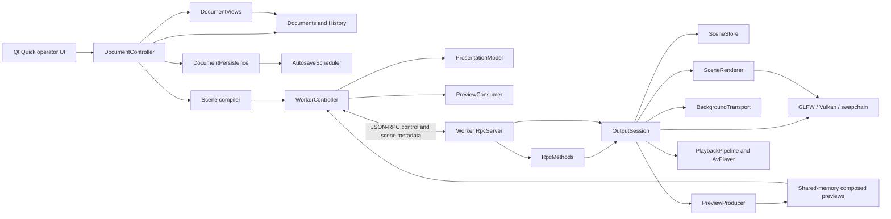

# Architecture and implementation audit

Audited 2026-10-29 against `1b54bdb` plus the SceneStore sharing change and the
6.18a2 `PreviewProducer` extraction described below. This is a source audit of
completed tasks, with current test results in
[PROGRESS.md](../PROGRESS.md). [PLAN.md](../PLAN.md) defines the intended design;
the [M6 review](M6-code-review.md) records the original findings, whose source
line numbers and descriptions are historical.

Current qualification (review of 2026-10-30 at code `8402e69`; closures
through 2026-10-31): the
[architecture follow-up review](reviews/M6-architecture-follow-up-2026-10-30.md)
finds seven remaining issues in shared shaping, GPU reclamation, audible retirement,
capacity handling, blocking media operations, standalone state and thumbnail
completion identity. Existing 6.21 DONE evidence stands; full architecture
conformance also required **6.22a–g** — and all seven have since closed, each
with its own fixtures, in the narrative below. The older closure narratives
were qualified by this source review, which did not run new tests; those
qualifications are now discharged leaf by leaf.

**6.22a** (shared shaping), **6.22b** (GPU reclamation), **6.22c** (audible
retirement) and **6.22d** (deferral under capacity) have since been closed: the
engine owns no shared
`FontCollection`, each threading context shapes in its own, and the two Skia
halves of the finding — unlocked family resolution, and text blobs completed
during a line's first paint — are recorded with fixtures. Device teardown
(`GpuYuvUploader::destroy`, `Swapchain::destroy`, `VulkanContext::destroy`) now
takes the same `graphicsQueueMutex()` a commit takes, so a retired transport's
`vkDeviceWaitIdle` is ordered against successor submissions; the review's
alternative (per-slot completion fences) is deferred to M7.1b, which owns
timeout and device-loss behaviour. And the retirement hand-off now establishes
the outgoing audio's silent state — `pause()` deactivates the old sink stream
and latches its clock before the lane exists — so a slow producer join extends
the player's object lifetime only, never its audibility. And the one-deep
retirement slot no longer blocks its realtime consumer: `applyBackground()`
reaches teardown only with the slot empty — otherwise it keeps the latest
wanted transition (`fPendingTransition`, latest wins, no queue) and returns
without a present, the status mirror keeps reporting the still-live transport
honestly, and the next `applyTransportOps()` pass retries after the reap.
The blocking-media finding (**6.22e**, split e1–e4 in the PLAN) is now closed
as well: the standalone duration is probed on the bring-up lane and travels
with the staged player, `media.standalone`'s accept probe runs on the prepare
executor behind a deferred reply, and a replaced or abandoned standalone
player is silenced at the hand-off and stopped on its
own one-deep lane (swaps behind it defer, latest wins), and the seek-completion
wait — up to 500 ms per feeder — now runs on its own flight: the pass fans the
jump out and a lane worker holds the wait, while the completing pass runs the
sink flush, the clock rebase and the fault report on the transport's thread;
momentary ops hold their turn behind an unfinished seek, and a transport
retired mid-flight takes its flight with it (the lane joins the seek worker
before the player's stop). No cold file parks the RPC thread, no audio join or
seek ack is paid on the frame tick. **6.22e (A5) is closed.** And the
standalone mirror now retires with its player: the swap's claim publishes the
pending-selection state — the wanted path with `live=false`, no position it
does not have, and the outgoing instance's error cleared for a replacement —
so status names the new selection as requested-not-yet-presented through a
slow bring-up instead of reporting the removed player as live beside a command
gate that already refuses it. **6.22f (A6) is closed.** And the thumbnail
completion now carries the destination it was read for: the lane records the
companion's cache generation and the decode extent at the hand-off, and the
collect installs only into a destination that still matches both — an extent
change or a stop/start during a delayed decode discards the stale picture and
re-decodes against the current one, while reuse across bands at one destination
stays valid. **6.22g (A7) is closed.** All seven follow-up findings are now
closed, each with the fixture named in its row below; the qualification this
section opened with is discharged, and full architecture conformance to the
[M6 review](M6-code-review.md) and this follow-up is claimed on that evidence.

## Ownership and dependencies

These boxes are responsibilities, not all separate classes. Preview production
graduated into `PreviewProducer` (task 6.18a2) and the background media into
`BackgroundTransport` (task 6.18b1), both beside `SceneStore`, task 6.18b2 moved
the bench/diagnostic drivers into their own `openshow-worker-dev` executable,
task 6.19a1 moved the frontend's transport into `RpcClient`: the socket, the
framing, the reply ledger, the send bounds and the write-stall deadline, task
6.19a2 moved the frontend's pictures into `PreviewConsumer`: the shm mapping and
the mirror, off-air and thumbnail frames copied out of it, task 6.19a3 moved
the acknowledged output model into `PresentationModel`: the revision mirror, the
latest-go rule, the clear derivation and the restore snapshot, and task 6.19a4
split the worker side the same way — `RpcServer` is the connection (accept,
framed read, hello gate, bounded queue and deadline, drain, shutdown) and
`RpcMethods` is the meaning of a request (the method table and the
status/notification encoders). What shares `WorkerController` now is the process
supervisor and its QML facade, which is the division the plan intends; the
planned split 6.19b1–b8 — the `DocumentPersistence` and
`DocumentViews` adapters out of `DocumentController`, then `Main.qml`'s shortcut
map, output panel, playlist panel, show page, edit page and settings page —
has now fully landed. **6.19b1**: `DocumentPersistence`
(`src/ui/DocumentPersistence.{h,cpp}`, `openshow-ui-core`) owns the scratch, its
executor, the decision protocol around an explicit save or load and the wording
of a refusal or a survivor, and `DocumentController` keeps the documents, their
history and what a decision does to them. **6.19b2**: `DocumentViews` (same
target) shapes the rows the views read — songs, a song's slides and their
backgrounds, the current slide's boxes, styles and the resolved style,
playlists with each entry's show resolved, the media registry, the drawer's
search, and the selected box's text, kind and asset — and is a pure reader with
no state of its own: where a shape depends on where the operator is, the
navigation arrives as a `Cursor` value the controller builds from the ids it
owns, and `selectedBox()` is the single resolution of the selection with its
positional fallback that the controller's own box-scoped edits go through
too. **6.19b3**: `ShortcutMap` (`src/ui/ShortcutMap.qml`) holds the window's
entire key table — 49 `Shortcut`s whose gates the component composes itself
from fact properties passed in (page, focus holders, canvas selection, on-air
state, settings opt-in) and whose activations leave as intent signals the
window handles — because two enabled `Shortcut`s for one key make Qt drop the
key, so R17's one-live-owner-per-key rule is only checkable where every
claimant is on one page. **6.19b4**: `OutputPanel`
(`src/ui/OutputPanel.qml`) is the right dock — the preview and every output
tool below it — mirroring `worker` status and dragging through `panels` on
its own; the window keeps only the anchors and the id the centre pages use,
and the 4.4 inline panel primitives became shared module files so extracted
panels carry the look without borrowing a window declaration. **6.19b5**:
`PlaylistPanel` (`src/ui/PlaylistPanel.qml`) is the left dock — playlist
chips, the running order with its reorder handles, row drag and nearest-gap
drop target, and the dirty-marked status line — every gesture addressing the
controller directly, so the window again keeps only placement and the id.
**6.19b6**: `ShowPage` (`src/ui/ShowPage.qml`) is the centre's show page —
slide list with its worker-drawn band, history and navigation rows, picture
panel and lyric editor — and it owns follow mode outright (nothing outside
the block ever read it), so its one window contract is `presentRequested()`:
presenting is the only act the keyboard executors share. **6.19b7**:
`EditPage` (`src/ui/EditPage.qml`) is the centre's edit page — the canvas
stage, the debounced worker picture of the slide under edit, the geometry
fields, the stack commands and the style panel — and because only the canvas
tracks the live rectangle a nudge commits from, the key map's nudge and step
executors live on the page and its `boxSelected` alias, the flag the two
Escape owners hand off on. **6.19b8**: `SettingsPage`
(`src/ui/SettingsPage.qml`) is the settings page — the two persisted toggles,
the fifteen-row cheat sheet and the service rows — and it and `ShortcutMap`
now name each other: the map is where a key changes, the sheet is the promise
the operator was given. That closes 6.19b; `Main.qml` is composition —
placement, the page gate, the focus facts and the executors — at 255 lines.

| Boundary | Implementation and evidence | Assessment |
|---|---|---|
| Editable documents and history | `src/domain/{documents,history,storage}.cpp`; the Qt session adapter in `src/ui/DocumentController.cpp` with durability in `src/ui/DocumentPersistence.cpp` and the view rows in `src/ui/DocumentViews.cpp`; `domain_tests`, `document_controller_tests` | Matches. The frontend owns editable state and package writes; history has one observed Documents and bounded snapshots; since **6.19b1** exactly one class decides when either is written to disk, and since **6.19b2** exactly one place spells what a list row shows. |
| Immutable render scenes | `src/scene/{scene,demo}.cpp`, `scene_tests` | Matches. Compilation resolves styles, geometry, item order and asset paths; the worker validates scene JSON. The scene library currently depends on domain types/compiler code, but neither uses Qt or GPU APIs. |
| Process separation | `src/worker/CMakeLists.txt`, `worker_is_qt_free`, headless preset | Matches. GLFW/Vulkan/Skia/FFmpeg/PipeWire stay in the worker. Qt Quick, process supervision and document adapters stay in the frontend. |
| RPC | `src/protocol`, `src/worker/rpc/{RpcServer.cpp,RpcMethods.cpp,OutboundQueue.h}`, `src/ui/{RpcClient,WorkerController,PreviewConsumer,PresentationModel}.cpp`; protocol/limits/transport/controller tests; prepare-time file work in `session/PrepareExecutor.{h,cpp}` | Matches the bounded metadata transport. Since **6.19a1** the frontend half has its own class: `RpcClient` owns the socket, the framing, the ledger of requests the worker owes, the size/backlog/in-flight refusals and the 2 s no-byte deadline, and interprets no result — a reply returns with its request's method name, connection generation and the caller's intent record, which is R3's rule kept in one place (`WorkerController::onRpcReply` decides meaning). Since **6.19a3** the scene operations the facade sends are decided by `PresentationModel`, which holds no transport of its own and reaches the ledger only through the injected callbacks. Since **6.19a4** the worker half is split the same way: `RpcServer` is the connection (accept, framed read, hello gate, bounded queue and progress-measured write deadline, drain, deferred-answer bag, shutdown) and `RpcMethods` is the method table and the status/notification encoders, answering through an injected sink so the prepare executor never learns a socket exists; only the connection can end a session. The deadline's measurement was fixed in **6.20c**: it runs from the moment the queue starts OWING bytes, not from the last byte that moved, so a frontend that takes everything and then goes quiet is idle rather than gone, while a peer that truly stops reading keeps the queue continuously non-empty and is still dropped on the window. Worker socket writes are nonblocking; since 6.9a dispatch schedules still decodes and media probes onto the bounded prepare executor and answers each request from its completion (self-piped wake, ids correlate), so a cold file delays no other command. |
| Media transport | `src/worker/session/BackgroundTransport.{h,cpp}` over `playback/{PlaybackPipeline,AvPlayer}`; `background_transport_tests` plus the live `background_media_tests` | Matches since **6.18b1** (2026-10-29). The transport owns the background pipeline and its feeder, the standalone track and its swap, the video seam's two bounded slots and their leases, the newest-wins intent slots, the typed faults and the media status mirror; the render-thread-owns-the-transport rule is stated in its header. Since **6.9b** (2026-10-30) it also owns the one primed background: `primeVideo` opens a prepared clip's file half on the prepare executor and parks it as the single prime, the render thread attaches that prime's GPU half at the frame boundary (or opens cold), and a superseded prime is closed on the thread that made it. Since **6.21c1** the prime carries the clip's audio half too: `primeAudio` starts a HELD `AvPlayer` on the executor (`Config::startHeld` — connection and negotiation, feeders, mixer and pre-roll all paid there, nothing audible, clock parked) and `applyBackground` adopts it under `fMutex`, retiring the current audio instance through `retireAudioInstance()` — swap under the lock, stop outside it — so the frame boundary releases a hold instead of building a transport. Since **6.21c2** the DEATHS run on lanes too: a teardown requests the producer's stop, nulls the atomic presenter, and moves pipeline plus audio player into a one-deep retirement slot whose thread joins the producer and stops the player; the render thread closes the GPU half (`reapRetirement()`), strictly after the join, when the lane reports done. The presenter is atomic and `submitVideo` filters by producer generation, which is what lets a successor start before the old pacing thread returns — R6's ordering is kept (close follows join; the retired objects live until their thread is reaped), only its WAIT moved. A second teardown while the lane waits DEFERS (task 6.22d): the newest wanted transition lives in one `fPendingTransition` slot, the call returns without a present, and the next transport pass retries it after the reap. The standalone track swapped the same way: the swap claims the current instance under `fMutex` (fresh silent placeholder), stops it outside, stages the new clip held on a bring-up lane, and a later transport pass publishes it — one stage at a time, a newer intent stays pending; shutdown drains both lanes. Since **6.22e1** the bring-up's result carries the track's duration (probed once on the lane), so publish reads no file under `fMutex`; since **6.22e2** the selection's accept probe runs on the prepare executor (`validateStandaloneTrack` then `armStandaloneTrack` behind `OutputSession::requestStandaloneAudioDeferred`) and the answer travels as a deferred reply — the RPC thread no longer opens files; since **6.22e3** the replaced or abandoned instance dies on a second one-deep lane of its own (pause at the hand-off, `stop()`'s joins on the lane, a swap behind a busy lane defers latest-wins) — the render thread no longer joins audio threads at all; since **6.22e4** the transport's seek is a one-deep FLIGHT (`beginSeekFlight` fans the jump out on the pass, a lane worker holds the per-feeder wait, the completing pass runs the finish half — sink flush, clock rebase — and the fault report, later momentary ops hold their turn behind an unfinished seek, and a teardown carries the flight to the retirement lane, joining the seek worker before the player's stop) — so no seek acknowledgment is paid on the frame tick either; since **6.22f** the swap's claim publishes the pending-selection state for a replacement as well as a removal (wanted path, `live=false`, no position, outgoing error cleared), so the mirror, the command gate and ownership move in one step and a removed player is never reported as current. The session keeps the loop's wake gate and the frame's present/lease calls, delegates the RPC verbs, and reads the mirror in `status()`. |

| Requested versus presented state | `src/worker/session/SceneStore.{h,cpp}`, `scene_store_tests`, `output_status_tests` | Matches. Decide captures commands together; landed state is distinct from published state. OutputSession reports the store's published state after successful presentation. |
| Composition and text | `src/worker/render/{SceneRenderer,SceneText,Layer}.{h,cpp}`; scene/frame/Unicode/pixel tests | Matches the shared worker text renderer, public Skia/ICU integration and direct audience composition. Since **6.9b** the layout cache belongs to each `SceneRenderer` — a companion borrows the engine's fonts and shaping, never the audience's four slots, its LRU clock or its miss counter (R16) — and a prepare shapes into the production renderer's own cache. Since **6.21a** the cache's contract is retention: slots hold `shared_ptr<const SceneLayout>`, `find()`/`put()` hand out copies of that handle, and replacing or evicting a slot releases only the cache's own reference — a draw holds the bytes it paints until it returns, whatever a concurrent prepare stores. Since **6.20d** the two layer toggles are a kind filter over the one authored item stack — `words` and `images` each hide their own kind, omission never reordering (see the open-differences table). Since **6.22a** the engine builds no shared `FontCollection`: `fontCollection()` hands every threading context its own instance over the shared `SkFontMgr`, so a frame-loop miss and a prepare-executor prewarm no longer resolve cold families inside one unlocked table. Shaping ownership has a second half: `skparagraph` completes a line's text blobs during that line's first paint, so a layout handle crosses threads by hand-off (prewarm → frame loop) but is painted by exactly one thread at a time — a rule production keeps by ownership, one frame loop per renderer. |
| Video and audio ownership | `src/worker/{media,playback}`, `src/worker/render/YuvGpu.cpp`; GPU/decode/queue/control/mix/sync tests | Matches bounded queues, displayed-image leases, generation checks and independent audio controls. Since **6.9b** a prepared clip's demux/decode half opens on the prepare executor (`PlaybackPipeline::openFile`) and the render thread's part is the Ganesh attach (`attachGpu`); a clip nobody primed still opens wholly on the render loop. Since **6.22b** every whole-device wait is a guarded queue operation: `GpuYuvUploader::destroy()`, `Swapchain::destroy()` and `VulkanContext::destroy()` hold `graphicsQueueMutex()` around `vkDeviceWaitIdle`, which is what the installed registry's `implicitexternsyncparams` require of it, so a retired transport's reclamation (6.21c2's lane, or a shutdown reap on the command thread) can no longer overlap a successor's guarded submit. The wait itself remains whole-device; fence-based per-slot retirement belongs to M7.1b with timeout and device-loss. Since **6.22c** audible deactivation is separate from object destruction: the teardown hand-off calls `pause()` on the outgoing `AvPlayer` (server consumption stops inside one slice, the clock latches, no thread is joined) before the retirement lane exists, so the lane's `join()`-then-destroy sequence extends the retired player's lifetime only — never its audibility. Since **6.22d** the retirement slot's one-deep capacity is a policy, not a wait: `applyBackground()` defers the newest transition into `fPendingTransition` (latest wins) when the slot is busy and returns without owing a present, `applyTransportOps()` retries it on the pass whose reap emptied the slot, and the teardown's old sleep loop survives only as a logged invariant violation on routing bugs. |
| Previews | `src/worker/session/PreviewProducer.{h,cpp}` over `src/worker/preview/PreviewStream.cpp`; the consumer is `src/ui/PreviewConsumer.{h,cpp}` (task 6.19a2), read through `WorkerController`; `preview_producer_tests` plus ownership/selection/budget tests | Matches. The producer owns the stream lifecycle, target arbitration, generation gates, thumbnail queue and budget policy; the session hands in frames and wakes the loop. Since **6.21d** a thumbnail's file read runs on its own one-deep decode lane: the RPC pump collects a finished decode (install + settle by path) or hands the next path to the lane and returns without waiting, so a cold 4K backdrop holds no command hostage; one file in flight keeps the memory and lookahead story of the old one-per-tick rule, and shutdown joins the lane. Since **6.22g** a completion carries the destination it was read for — the companion's cache generation and the decode extent, captured together at the hand-off — and the collect installs only while that destination still stands, so an extent change, a stand-down or a stream restart during a delayed decode discards the stale picture and re-decodes for the current one; reuse across bands at an unchanged destination stays valid, and the status counters describe the standing companion only (no destination, no decoded bytes). The consumer owns the mapping, its own two ask generations, the asked/wanted dedupe, the byte-bounded thumbnail LRU and the stand-down re-issues, and asks only through the transport its host injects. Shared memory with exact stream/sequence release; output and audience mirror use the same captured frame; edit selection and thumbnails deliberately render separate scenes. Readback is synchronous. |
| Persistence | `src/domain/storage.cpp`, `src/ui/{AutosaveScheduler,DocumentPersistence}.cpp`; domain/controller tests | Matches durable staged package writes, asset adoption and coalesced background autosave. Since **6.19b1** the coordination has one owner: `DocumentPersistence` runs the decision protocol (quiesce, write or discard, remove the scratch the decision made stale with its survivor reported, reopen), the deferred refusal surfacing that keeps the crash net, the 2.3 startup rule and the quit-edge durable wait. Explicit save/load and decision waits remain synchronous. |
| Demo isolation and dependencies | `render/TestScene.cpp`, `cmake/OpenShowSkia.cmake`, `scripts/build-skia.sh`; production/pixel/public-API guards | Production starts black and uses SceneRenderer without a demo builder. Since 6.18b2 the demo scene and the diagnostic drivers compile only into `openshow-worker-dev`; the product binary cannot reach them. Skia is a pinned submodule with public application includes and compatible ICU. |

## Review closure: R1–R19 evidence matrix (task 6.20a)

The review's completion rule says every finding must have passing regression
evidence or an explicit M7 gate, and that "the new behavioural regressions
pass". This matrix is that accounting. A row is evidenced when its named
fixtures exist in the ctest inventory of the stated preset and pass its
recorded gate; the current green run is the closing gate recorded for
**6.20d** in [PROGRESS.md](../PROGRESS.md), whose desktop run covers all 54
tests including all 13 display-labelled ones, and whose headless run covers
all 32 — every fixture named below passed in it. Preset marks: **H** runs in the headless
inventory (and therefore in both), **D** is desktop-build only without a
display label, **D✦** is desktop-build and display-labelled. Where M6
deliberately left work, the row carries the explicit M7 reference from the
review's own mapping; where this matrix found a finding bare, it records it
bare. The matrix reports; it does not paper.

| Finding | Closed by | Fixtures pinning it | Open remainder |
|---|---|---|---|
| **R1** production output used the development scene | 6.1a–b; 6.18a1, 6.18b2 | `production_output_tests` (D✦: fresh `--socket` worker reads black, uniform including the footer region), `render_production_compositor` (H), `render_scene_snapshot`/`render_layer_composition`/`render_scene_transition` (H), `worker_is_qt_free`/`worker_check_deps` (H) with `openshow-worker-dev` carrying the demo/bench drivers | none |
| **R2** repeated audio starts and standalone-only playback failed | 6.7a–b; transport state in 6.18b1; audio-contract decision 6.20d | `audio_mix_tests` (H: restartable mixer, stable source identities, sinkless clock semantics), `av_sync_tests` (H: audio→audio, silent→audio, failure→retry), `background_media_tests` (D✦: live transport restarts) | none — the two-transports-vs-one-mixed-stream wording is resolved as the accepted design with reasoning (6.20d); both-streams-audible is **7.4** device acceptance |
| **R3** rapid scene requests could show the wrong slide | 6.3a–b; 6.19a1, 6.19a3 | `worker_controller_tests` (D: ID-correlated replies, connection generations, latest-go-wins, backlog refusals — unchanged across both extractions), `scene_edit_tests` (D: clear-derivation against the pending logical state) | none |
| **R4** status acknowledged state before a frame presented it | 6.4; 6.18a1 | `output_status_tests` (D✦: applied fields credit only the successfully presented frame; command injected during apply; acquire/present failure injected), `scene_store_tests` (H: desired/landed/published distinct) | none |
| **R5** preview release did not prove ownership | 6.5; 6.18a2, 6.19a2 | `preview_stream_tests` (H: exact published-sequence acceptance, stale/future/odd rejected), `preview_producer_tests` (H), `preview_ownership_tests` (D✦: stop/start with outstanding frames, delayed releases, consumer-owned slot never changed) | none |
| **R6** a held video token outlived its ownership | 6.6a–b; 6.18b1; 6.21c2 (retirement re-expression); 6.22b (queue-guarded reclamation); 6.22c (silent hand-off); 6.22d (deferral under capacity) | `background_media_tests` (D✦: paused/final frame redrawn while decoder attempts reuse; quiesce-before-replacement; slow-exit retirement keeps frames clean across the overlap), `background_transport_tests` (H; with a real clip's audio, a real PipeWire stream and a headless device: the retired player paused at the hand-off and its server delivery frozen across the scripted slow exit; A→B→C and A→B→clear deferred at 0.0 ms and landed on a loop pass while A's scripted retirement ran), `gpu_decode_tests`/`playback_queue_tests` (H: displayed-frame lease, generation check; reclamation waits behind the queue's guard, twelve overlapped reclaims beside a committing producer) | none open for retirement audio or responsiveness; synchronous media work beside retirement is **6.22e (A5)**. |
| **R7** saving recovered media deleted the active source paths | 6.12; 6.19b1; 6.21b; real-worker adoption 6.21g | `document_controller_tests` (D: recover→save→present→edit→undo/redo→save with the original source removed — the review's probe sequence as a regression), `domain_tests` (H: durable package-owned adoption), `worker_controller_tests` (D: a foreground image adopted settled and mid-prepare, its per-prepare item paths asserted through clear-all/restore), `frontend_journey_tests` (D✦: both plates renamed on disk, adopted without moving the audience, and the later restore draws both pictures from the new paths with the old names gone and no foreground fault) | Closed by **6.21b / F2**: adoption rewrites every path-bearing scene item, not just the background, across mirror, in-flight prepares, desired content and restore snapshot. Real-worker adoption coverage landed with **6.21g**. |
| **R8** save atomicity protected only the manifest | 6.13a–b | `domain_tests` (H: staged content-addressed assets, commit after durable bytes, fault-injected copy/commit against an existing package, ID validation and symlink-aware containment) | recorded scope: complete bytes guaranteed; strict version rollback not promised |
| **R9** private Skia dependencies and an ICU impersonation | 6.2a–c; guard re-read 6.20b | `skia_public_api_guard` + `skia_public_api_guard_negative` (H: `CheckNoSkiaPrivate` over the production sources, the negative proving the guard can fail), `unicode_text_tests` (H: combining marks, emoji sequences, CJK wrapping, mixed direction), `gpu_yuv_tests`/`gpu_decode_tests` (H: independently specified conversion expectations) | standing practice, not a gap: public APIs still require controlled upgrades, no ABI guarantee. The 6.20b re-read confirmed the directory-scoped glob covers every module added since 6.2a and closed one real gap: Skia's root is an exported include directory, so `<src/...>` resolved at compile time while the guard matched only quoted includes — it now refuses both forms, and the negative fixture trips on both |
| **R10** preparation blocked RPC and presentation | 6.9a–b; 6.18b2; 6.21c1–c2; 6.21d; 6.22d (deferral under capacity); 6.22e1 (staged standalone duration); 6.22e2 (deferred standalone probe); 6.22e3 (standalone stop on a lane); 6.22e4 (seek wait on a flight) | `prepare_executor_tests` (H: exactly-once, capacity, cancel, stop contract), `background_media_tests` (D✦: status/displays/release answered during four cold 4K prepares; slow-retirement present→air 4.5 ms and bed-swap ack 1.6 ms against 700 ms scripted waits, audience gap ≤ 26 ms; a 600 ms standalone probe deferred off the RPC thread with status RTTs ≤ 0.8 ms through the window), `preview_selection_tests` (D✦: status and release ≤ 0.6 ms through a 600 ms scripted cold thumbnail decode, shutdown mid-read drained), `background_transport_tests` (H: a scripted 500 ms standalone probe costs no transport pass and no status read; a scripted 700 ms player stop costs the swap pass 1.4 ms with the retiring delivery frozen at the hand-off and the removal deferred, not waited; a scripted 300 ms seek ack costs the seek pass 0.1 ms with a mid-flight pause held and applied behind the completion), `render_idle_check` (D✦), `worker_rpc_lifecycle` (D✦) | **6.22e (A5) closed.** Standalone status transition closed by **6.22f** (`background_transport_tests`: through a 700 ms scripted bring-up the block says `live=0`, the wanted path and no position, and the gain command refuses the same way; the removal-only control reports the gone player live at a frozen position). |
| **R11** control transport limits were incomplete | 6.8a–b; 6.19a1, 6.19a4; audit table updated 6.20b; deadline measurement fixed 6.20c | `protocol_tests`/`scene_tests` (H: encoded-size, per-method budgets, envelope validation), `outbound_queue_tests` (H: bounded writer), `worker_rpc_limits` (D✦), `worker_rpc_transport` (D✦: slow-peer disconnect, no lock held against rendering), `worker_controller_tests` (D: in-flight bound, 2 s no-byte deadline), `production_journey_tests` (D✦: a long quiet frontend survives — the deadline runs from the debt, not from the last write) | none — the review's audit table now states the enforced numbers (1 MiB both directions, depth 8, scene budgets, outbound queue, echo clip, thumbnail bounds) rather than review-time claims |
| **R12** decoded-image memory grew for the worker's lifetime | 6.10 | `scene_image_cache_tests` (H: byte-accounted eviction, budget-exceeding sequence, missing→repaired same-path recovery), `background_media_tests` (D✦: pins across live transitions) | pinned resources above the eviction budget are reported, not evicted — open-difference row above; measurable budgets are **M7.2** |
| **R13** preview mutated live transitions; fades were not a lerp | 6.11a–b | `scene_frame_tests` (H: one immutable audience frame), `preview_budget_tests` (D✦: previews cannot advance fades), `live_fade_tests` (D✦), `scene_render_tests` + `render_layer_guard`/`_negative` (H: image→image and same-image pixel composites, no intermediate targets) | synchronous GPU readback remains in the render loop, bounded by the deferred-after-overrun budget — open-difference row above; cost measurement is **M7.2** |
| **R14** recovery writes blocked the UI and errors were discarded | 6.14a–b; 6.19b1 | `document_controller_tests` (D: coalescing scheduler, decision epochs an older write cannot outrun, refusals surfaced with the crash net kept, close-during-debounce flush), `domain_tests` (H: reusable unchanged-asset copies) | explicit save/load and decision drains remain synchronous by recorded decision — open-difference row above |
| **R15** promised features existed only below the production boundary | 6.15a–b; 6.18b1 (production and bench drive the same object); audio-contract decision 6.20d | `playback_control_tests` (H: play/pause/seek/loop, per-source gain/mute as typed protocol), `background_media_tests` (D✦: standalone track lifetime independent of slide/video replacement; final frame and loop-off), `worker_rpc_lifecycle` (D✦: the verbs on the real socket), `ui_loads` (D) | none — the two production streams are the recorded contract (6.20d), their audible pairing on hardware is **7.4** acceptance |
| **R16** editor imagery and thumbnails did not follow the planned renderer | 6.16a–b; 6.19a2; 6.21a; 6.22a; 6.22g (destination-carrying completion) | `preview_selection_tests` (D✦: selected unpublished scene and bounded thumbnail batches over the shm transport, audience untouched), `worker_controller_tests` (D), `ui_loads` (D: band-drawn rows), `scene_render_tests` (H: retained layouts survive eviction, same-key replacement and a concurrent prepare churn; per-thread shaping collections, six-context cold resolution and a prepare→frame hand-off), `preview_producer_tests` (H: a 600 ms scripted decode outlived by a 64→256 extent swap and by a stop/start at the SAME extent — the cache is left holding only the destination that asked, byte-exact, with the stale picture discarded and re-decoded; the controls adopt it: wrong-extent pixels 16 KiB into a 256 KiB ask, and a second entry for a cache that was retired) | Fixed: retained layout lifetime (6.21a), per-thread shaping ownership (6.22a), completion compatibility (6.22g). |
| **R17** authoring was narrower than the plan | 6.17a1–c3; 6.19b2/b3/b7/b8; images/words toggle resolved 6.20d; gradient clear 6.21e | `document_controller_tests` (D: multi-box model, one selection resolution, geometry, ordering, images), `scene_edit_tests` (D: compile path; both gradient shapes cleared — the key leaves the payload, not just the value — and the flag counts a black-to-colour ramp), `worker_controller_tests` (D: S16 — the acked indicator lit for a gradient, the peer's per-prepare ledger showing the cleared payload naming no gradient, the restore naming it again), `scene_render_tests` (H: mixed text/image draw order, the words/images kind filter over the one stack, fits, gradient), `production_journey_tests` (D✦: the live audience sampled #F87C00 at the floor through a black-top ramp and #000000 at both ends after the operator's clear), `ui_loads` (D: canvas and inspector; the key table's one-owner-per-key rule verified live by its unchanged notice set) | Closed by **6.21e / F4**: `dropBackground()` erases the optional gradient (its absence is the flat answer the codec defines) and `sceneContent()` counts the key as a live background. Keyboard automation remains absent; kind-filter pixel coverage remains valid. |
| **R18** remaining failure handling was visibly incomplete | 6.7c (typed decoder/feeder/sink/background failure state); per-item foreground lane 6.20d; frontend projection 6.21f | `media_tests`/`av_sync_tests`/`playback_control_tests` (H: failures carried as typed state, not claimed-on-air), `background_transport_tests` (H), `output_status_tests` (D✦: S3 — a broken stack picture named per asset path in `output.status`, updating not duplicating across attempts, cleared by the repair without un-counting, media lane untouched), `worker_controller_tests` (D: S17 — the list projected into `foregroundErrors`/`foregroundFailureEvents` with path and reason verbatim, a second path extending it, the notice clearing on an acknowledged repair while the monotonic count stays counted and the transport's own fault line stays faulted throughout) | Closed by **6.21f / F6**: `PresentationModel` reads the bounded array and the event count, `WorkerController` re-exports both as `sceneChanged` properties, and `OutputPanel` shows path + reason (+ how many more, and the event tally) in its own amber line beside the media lane. Restart/device-loss/bounded GPU waits remain **7.1a–c**; redraw/drift accounting remains **7.2**. |
| **R19** seek acknowledgements and frame deadlines disagreed | 6.7d | `playback_control_tests` (H: generation paired with the target actually applied), `av_sync_tests` (H: failed audio seeks not acknowledged), `playback_queue_tests` (H), `background_media_tests` (D✦: rapid, backward-after-loop and paused seeks through the real session with the shared deadline mapping) | none |

The completion rule's running obligations sit with their own leaves: the
guard re-read and the audit table update landed in **6.20b** (the guard
grew teeth for the angle-bracket include form and its negative for both
forms; the review's table now carries the enforced numbers) and the
production author→preview→go→clear→restore→media-swap proof landed in
**6.20c** (`production_journey_tests`: the whole journey through the real
`DocumentController` and a real `--socket` worker, asserted in status and in
preview pixels; it also pinned the two revision counters — mirror frames
carry the present ack's output revision, `scene.active` and selection frames
the prepared revision — and its first green run required fixing the worker's
write deadline, which dropped an idle-but-healthy frontend by the first frame
owed after 2 s of quiet). **6.21g** added the night the review said was missing:
`frontend_journey_tests` runs the show through `WorkerController` and
`PresentationModel` themselves over a supervised real worker — the gradient
acknowledged, per-layer clears composed against the pixels, the restore
re-preparing across the store's 16-deep pruning (one id past the 18th bare
filler, so a remembered revision cannot be what returned), both renamed plates
adopted without moving the audience and drawn again from the new paths, and a
real missing-picture fault reaching `foregroundErrors` with its reason and
leaving it on the repair — so the frontend's own decisions, not a hand-written
socket stand-in, carry the journey evidence (`production_journey_tests` remains
the raw-protocol coverage). The three named architectural differences were
recorded as decisions in **6.20d**: the `words`/`images` toggles became a
kind filter over the one authored stack (code-to-contract, pinned by
`testWordsImagesFilterTheStack`), the two PipeWire streams became the
accepted audio contract with the reasoning and a **7.4** device gate
(contract-with-reasoning), and per-item foreground failures became an
`output.status` lane beside the media lane rather than inside it
(code-to-contract, pinned by `output_status_tests` S3). The closure itself —
final gates and this matrix's honest skips — was recorded in **6.20e** under
"M6 closure: the completion rule in writing" below.

## M6 closure: the completion rule in writing (task 6.20e)

The review's completion rule says M6 closes when "the new behavioural
regressions pass, the direct-private-Skia guard passes, API traffic is
measured, and the old gates remain green with skipped hardware checks
recorded honestly." Here is each clause against the run that proves it, and
then the checks no run here made — named at the point they were skipped, so
nothing has to be chased through scattered notes to find the edge of what
this milestone actually shows.

- **The new behavioural regressions pass.** Every R1–R19 finding above has
  its named fixtures, and every one of them sits in the stated preset's
  inventory and ran green in the final gate.
- **The direct-private-Skia guard passes.** `skia_public_api_guard` and its
  negative twin match both include spellings — quoted and angle-bracket,
  the gap 6.20b found and closed — and both run in the headless suite the
  final gate is.
- **API traffic is measured.** The audit table in
  [M6-code-review.md](M6-code-review.md) carries the enforced numbers
  rather than review-time claims: 1 MiB both directions, depth 8, the
  per-method scene budgets, the per-frontend outbound queue (1 MiB / 1024
  frames, nonblocking writes), the 160-byte echo clip, the thumbnail
  bounds; the stall deadline runs from when the queue starts owing bytes,
  not the last byte that moved (6.20c).
- **The old gates remain green.** Recorded for task 6.20d at `2fb3131`:
  desktop **54/54** (247.9 s, all 13 display-labelled tests, 137.8
  sec*proc), headless **32/32** (51.2 s), both trees building clean. Task
  6.20e changes prose only, so those runs describe the closing tree.

### Recorded skips

What this milestone's evidence did not attempt, each named at the point it
was skipped. Nothing in the matrix's rows or the four clauses above claims
these:

- **Audible playback.** The production journey (6.20c) runs a deliberately
  silent show — text and stills only; `pipewire-0` is present and unused —
  and the audio decision (6.20d) moved contract wording rather than code
  precisely because its open claim, two simultaneous streams audible on
  hardware at acceptable relative latency, is a device claim. Owed by
  **7.4**.
- **Target-GPU versus software-rasterizer distinction.** The journey's own
  output records that this machine's RADV device (AMD Radeon 890M) is not
  told apart from llvmpipe by any check the M6 suite has. Timing evidence
  on the target GPU is owed by **7.4**.
- **Projector placement, DPI and stacking; physical second displays on
  Wayland and X11; unplug/replug.** The display-labelled fixtures drive a
  real worker window (GLFW on Wayland here) and assert composition and
  hand-offs — never geometry on hardware. Owned by **7.1c** and **7.4**.
- **Long-run gates.** The thirty-minute A/V continuity, ten-minute deadline
  and one-hour mixed-service runs are not in the recorded 247.9 seconds;
  historical M5-era numbers stay historical, exactly as their ledger rows
  already say. Fresh runs are **7.4**.
- **Keyboard coverage.** The cheat-sheet/`ShortcutMap.qml` alignment was
  verified by reading both files against each other (6.19b3, re-checked by
  the unchanged live notice set in `ui_loads`); no automated keyboard test
  exists that could operate them. Recorded bare in the R17 row.
- **Restart and device-loss behaviour.** Worker supervision and restart
  reset, destination-removal disabling, device-loss classification and
  bounded acquire/fence waits are owned by **M7.1a–c** exactly as the
  review mapped them; no M6 fixture pretends to cover them.
- **Accounting and cost budgets.** Redraw/onPresented accounting, signed
  A/V drift, the pinned image cache's excess above its eviction budget and
  one synchronous GPU readback's worst-frame cost are counted where the
  counters exist, but no measured budget bounds them. Owned by **7.2**.

With the four clauses matched to the recorded runs and every skip named at
its point, the review's completion rule is discharged: **M6 is closed** for
what those runs prove, and everything they do not prove has a numbered
owner in M7.

## Open differences from the plan

These limit what historical DONE statuses prove. The review linked above adds
6.21 corrective work; the rows below retain the original decisions and evidence.

| Difference observed in source | Consequence | Follow-up |
|---|---|---|
| **Closed by 6.9b** (2026-10-30) for the prepared path: `BackgroundTransport::primeVideo` opens a prepared clip on the prepare executor, `SceneRenderer::prewarmLayouts` shapes into the production renderer's own layout cache, and `preloadScene()` decodes a blur background's backdrop — all before go, all off the frame loop. What remains is the miss path: an unprimed video still opens on the render thread, `SceneItemsLayer::layoutFor()` still shapes a layout it was never given, and `SceneImageCache::backdropFor()` still builds a missing backdrop synchronously. | A primed scene's frame boundary costs no file work (measured: present→air ~15 ms with a 700 ms scripted open, warm p95 ~9 ms); a scene no prepare primed can still miss a frame deadline, which is the fallback's honest cost rather than a hidden one — the trio `status.scene.images` reports (`drawDecodes`, `drawBackdrops`, `layoutBuilds`) counts exactly those. | **7.2/7.4** soak the miss path against real media; keep it measured, do not re-describe the first blur build as outside the frame loop. |
| **Closed by 6.20d** (2026-10-30), code-to-contract: the `words` and `images` bits now gate the authored item stack TOGETHER (`SceneItemsLayer::dispatchGate()` answers to both) and filter its entries by KIND — `words` off draws only the stack's pictures, `images` off only its paragraphs, each kind keeping its authored position and fade alpha. A stack omits; it never reorders, so the authored overlap of whatever remains is exactly what it was. `FrameContext.layerMask` carries the mask per R13's content rule; the development decoration's stand-in photo remains what it always was, the `kImages` layer's own content, standing down whenever a presentation is on air. | The operator's two toggles control their own kind and nothing else: images off leaves words standing, words off leaves pictures standing, and hiding a picture reveals the words beneath it at the pixels they always held — not at pixels a re-stacked layout would pick. Snapshot path mirrors the gate (`SnapshotOptions.images`). | **Closed by 6.20d**, pinned headless by `scene_render_tests::testWordsImagesFilterTheStack` (four frames: both up, images off, words off, both off — magenta/fill/white-pixel positions prove kind filtering without reordering). |
| `DocumentController::save()` waits for autosave quiescence and calls `saveServiceAndAdopt()` inline; load and quit also drain synchronously. | 6.14b proves background **autosave**, not that all persistence is off the UI thread. | **6.19b1** gave the coordination one owner (`DocumentPersistence::saveToService`/`loadFromService`: quiesce, write, scratch removal and its survivor wording, resume), which is the precondition for moving it and does not itself move it — the write still runs on the UI thread. **6.20** records the remaining responsiveness limit. |
| Preview rendering/readback runs on the render thread after output; its budget defers future attempts after an overrun (now inside `PreviewProducer::fillPreviewSlot`). | It bounds average preview work and drops owned slots, but cannot prevent one expensive readback delaying the next audience frame. | Extraction done (**6.18a2**, 2026-10-29) without changing the policy. **6.9b** (2026-10-30) measured the loop THROUGH a slow off-loop open instead of assuming it: the audience's presented frames advanced with a 50 ms worst gap while a scripted 700 ms open ran on the executor. **7.2/7.4** still owe one readback's worst-frame impact. |
| SceneImageCache retains pinned resources even above its 192 MiB eviction budget. | The budget bounds evictable decoded data, not total process/GPU memory; pinned excess is reported. | **7.2/7.4** resource accounting and service soak. Do not describe it as a hard total-memory cap. |
| **Closed by 6.20d** (2026-10-30), code-to-contract: `preloadScene()`'s per-item failures now ride a dedicated reporting lane — `status.scene.foregroundErrors` names each asset path whose last prepare attempt failed, with that attempt's reason clipped to the echo budget, capped at 8 entries beside a monotonic `foregroundFailureEvents` that keeps truncation visible; entries clear when a later prepare's `refreshFor` decodes the path again. The acknowledged media lane stays background-only BY decision — a stack picture's decode error must not evict the transport's truth from `media.error` — and this lane sits beside it rather than inside it. | A missing foreground box is honest on screen (its box shows what is under it) AND now honest to anything asking: "which picture is missing, and why" is an `output.status` question — and since **6.21f** the operator's own panel asks it. | **Closed by 6.20d**, pinned live by `output_status_tests` S3 (missing file → named path + reason + event; re-prepare of the same broken path → updated entry, counted again, never duplicated; file put back → cleared, events not un-counted; `media.error` empty throughout). Frontend half closed by **6.21f**, pinned by `worker_controller_tests` S17. |
| The 6.18a2 extraction landed 2026-10-29: `PreviewProducer` is built (`openshow-worker-preview-producer`), used by OutputSession through a thin delegating seam, and pinned headless by `preview_producer_tests`. The 6.18b1 extraction landed the same day: `BackgroundTransport` (`openshow-worker-session-transport`) owns the background media and its status mirror. The 6.18b2 split landed the same day: the bench/diagnostic drivers and `render/TestScene.cpp` moved out of worker main into the `openshow-worker-dev` executable, leaving the product binary socket-mode only. The 6.19a1 extraction landed 2026-10-30: `RpcClient` (`src/ui/RpcClient.{h,cpp}`, in `openshow-ui-core`) owns the frontend socket, framing, reply ledger, send bounds and write-stall deadline, driven by an unchanged `worker_controller_tests`. The 6.19a2 extraction landed the same day: `PreviewConsumer` (`src/ui/PreviewConsumer.{h,cpp}`, same target) owns the frontend's shm mapping and the mirror/off-air/thumbnail frames, asking through injected callbacks and reading only its own replies, with `scene.prepare`'s intent shared through `src/ui/SceneAsk.h`. The 6.19a3 extraction landed the same day: `PresentationModel` (`src/ui/PresentationModel.{h,cpp}`, same target) owns the frontend's acknowledged output model — the revision mirror, the latest-go rule, the pending logical presentation the clears compose against, the restore snapshot and the asset-path adoption — with the facade's six scene properties and its go/clear/restore/adopt invokables forwarding unchanged. The 6.19a4 split landed the same day, closing 6.19a: `RpcMethods` (`src/worker/rpc/RpcMethods.{h,cpp}`, compiled into the worker binary) owns the method table and the status/notification encoders, and `RpcServer` keeps only the connection — and `WorkerController` keeps the supervisor and the QML facade, which is the planned division. The 6.19b1 extraction landed the same day: `DocumentPersistence` (`src/ui/DocumentPersistence.{h,cpp}`, `openshow-ui-core`) owns the scratch, its executor, the decision protocol, the startup rule and the durability wording, with `DocumentController` still the one documents-and-history owner and its public persistence surface unchanged. And the 6.19b2 extraction landed the same day: `DocumentViews` (`src/ui/DocumentViews.{h,cpp}`, same target) owns the row shapes the views read, a stateless reader over the documents with the navigation passed in as a `Cursor`, `selectedBox()` the single selection resolution the controller's edits also resolve through, and the controller's property getters forwarding. And the 6.19b3 extraction landed the same day: `ShortcutMap` (`src/ui/ShortcutMap.qml`) is the window's entire key table — every sequence, its gate, and its intent as a signal — with no key's owner, sequence or gate changed and the live notice set proving the shortcuts register from the new file. And the 6.19b4 extraction landed the same day: `OutputPanel` (`src/ui/OutputPanel.qml`, with `PanelField.qml`/`PanelButton.qml` becoming shared module files) is the whole right dock — preview canvas, monitor picker, layer toggles, per-layer clears and Restore, transport and mixer rows, standalone track and the device/frame/revision line — with the window keeping only placement. And the 6.19b5 extraction landed the same day: `PlaylistPanel` (`src/ui/PlaylistPanel.qml`) is the whole left dock — chips, running order, reorder handles, drag and nearest-gap drop target, the dirty-marked status line — its gestures addressing `docs` and its rows the `DocumentViews` projections. And the 6.19b6 extraction landed the same day: `ShowPage` (`src/ui/ShowPage.qml`) is the centre's show page — band-fed slide list, follow-presenting, history and navigation rows, picture panel and lyric editor — owning `following` outright and asking the window only to present. And the 6.19b7 extraction landed the same day: `EditPage` (`src/ui/EditPage.qml`) is the whole edit page — canvas stage, debounced slide picture, geometry fields, stack commands and style editor — with the nudge/step executors beside the canvas whose rectangle they move and one `boxSelected` alias for the key map. And the 6.19b8 extraction landed the same day, closing 6.19b: `SettingsPage` (`src/ui/SettingsPage.qml`) is the whole settings page — the two persisted toggles, the cheat sheet that mirrors the key table the operator was promised, and the service rows — and `Main.qml` is a 255-line composition of these components, placement, the focus facts and the executors. | Every planned component now has its own file and its one owner; nothing in the ledger remains to extract, and what this difference still owes is 6.20's review closure, not a boundary. | **Closed by 6.19b8** (2026-10-30). |
| Stable display identity, destination-removal disabling and complete restart/device recovery are not complete. | Historical display tests and successful launch/shutdown do not establish M7 failure recovery. | **7.1a–c**, physical Wayland/X11 and projector acceptance. |

## Contracts to retain during optimization

- `SceneStore` owns prepared IDs and desired/landed/published output state.
  Prepared scenes are immutable shared instances; a pin survives store eviction.
  The session acquires its mutex before the store mutex, never the reverse.
- `SceneFrame` captures one audience moment. Drawing another target does not
  advance a transition or publish a revision. Publication means successful
  submission/presentation to the window system, not proof of physical scanout.
- The audience composition pass creates no per-layer/intermediate render
  target or `saveLayer`. Preview/snapshot targets and cached CPU blur data are
  separate resources, not extra audience composition layers. Source guards
  supplement pixel tests; they are not a timing proof.
- RPC has a 1 MiB encoded JSON payload limit in both directions, a bounded
  outbound queue and 64 frontend in-flight requests. Original assets, decoded
  media and audio buffers never travel in RPC. Composed preview pixels use
  shared memory; ready/release messages carry metadata.
- Since **6.19a1** the frontend half of those bounds is `RpcClient`, and the
  rule it enforces is the one R3 was about: a reply is delivered to the request
  its id names, on the connection generation that request was written on, and
  with the intent that request's sender attached — nothing in the frontend
  dispatches on result shape, so a burst of prepares cannot misattribute a
  payload or fire a stale auto-present. A message that would exceed the payload
  limit, the 4 MiB backlog or the 64-request ledger is refused locally, with the
  reason and without consuming an id; the connection is ended only when the peer
  has taken not one byte for 2 s, which is a measurement of progress and never
  of queue depth, so a worker that is merely slow keeps its session (R11).
- Since **6.19a2** the frontend's pictures are `PreviewConsumer`, and the rule it
  owns is the one R16 was about: a frame is painted only when it belongs to the
  stream this client mapped and answers the newest ask that target made, so a
  late edit frame or a scrolled-past thumbnail is released like any other slot
  and never reaches a canvas. What the UI *wants* is kept separate from what the
  socket *carried*, which is why a cold start, a stream restart and a worker that
  stood a target down on its own each end with the picture rather than a
  placeholder; the thumbnail cache is bounded by count and by decoded bytes. It
  sends through the transport its host injects and applies the same scene budget
  a present passes, so authoring-side refusal stays one rule (R11), and it
  interprets no reply except the acks its own asks expect (R5).
- Since **6.19a3** the acknowledged output model is `PresentationModel`, and the
  truth it holds is the one R3 and R5 were about: a QML scene property reads a
  single owner, so an indicator cannot light from a request that was refused and
  a clear cannot compose against a payload the operator has already replaced.
  The revision mirror records only payloads this session sent, the newest go is
  tracked separately from the store's counters so a late ack for a superseded
  go cannot move the audience backwards, and a restore keeps its
  content until a status answer confirms the restored revision is actually on
  air. It sends nothing itself — its host injects the live gate, the request
  sender, the prepare-intent handle, the visit over pending prepares and the
  status line — and it reads only the prepare ack and the `scene` block of
  `output.status`, never the shape of any other result (R5).
- Since **6.19a4** the worker answers requests through `RpcMethods`, and the
  division keeps the two rules the connection and the table were each trusted
  with: only `RpcServer` can end a session — a method is refused, never
  punished, and an unknown name is answered rather than dropped — while the
  table owns every argument width, range check and refusal text before a
  session operation is called, so an argument nobody sent still cannot move the
  audience at the new seam (R11). Operation names, error codes and result
  shapes remain the shared typed definitions in `openshow/protocol`: the split
  could not add vocabulary for the frontend and server to drift over (R3). The
  deferred `scene.prepare` ack crosses the seam as a shaped frame through an
  injected sink, so the prepare executor thread stays as socket-ignorant as the
  table that calls it (R10).
- Since **6.19b1** durability is `DocumentPersistence`, and the rules it keeps
  are the ones R7 and R14 were about. A decision owns the scratch alone: the
  epoch rises first, queued autosaves are dropped and an in-flight write waited
  out, so an older job can neither land after the clear nor ack as though it
  still mattered. A refusal leaves the crash net in place and lands DEFERRED so
  it is the last word the operator reads, with the stale flag suppressing a
  warning the scratch has already made untrue. A committed save or load that
  cannot remove the scratch it superseded NAMES the survivor, because a later
  startup would recover it as unsaved work. And because the scratch a save
  deletes may be exactly where a history snapshot points, the rebinds come back
  from the write for `History::adoptAssets` — the state that matters is the one
  `save()` returns with, in which no snapshot names a deleted path (R7). The
  adapter holds no documents and no history of its own; the controller stays the
  one owner and is the only caller.
- Since **6.19b2** the row shapes are `DocumentViews`, and the rules it keeps
  are the ones R16 and R17 were about. A row has ONE author: the running order,
  the drawer, the slide list, the canvas chrome and the inspector all read the
  same map, so the same fact cannot be spelled five subtly different ways on
  the way to the screen. The reader is stateless — it holds a const reference,
  caches nothing, emits nothing — so a row can never be one edit behind the
  model that owns it. And the selection resolves in ONE place: `selectedBox()`
  is the sole resolution of the cursor's box with its fallback to the bottom of
  the stack, the controller's box-scoped edits go through that same call, and
  the R17 promise that the highlighted box is the edited box is a property of
  the code. Navigation reaches the views only as a `Cursor` value the
  controller builds from the ids it owns — views cannot hold a stale position
  because they hold no position at all.
- Since **6.19b3** the key table is `ShortcutMap.qml`, and the rule it keeps is
  R17's: exactly one live `Shortcut` per key per context, because Qt drops a
  key two enabled owners claim rather than picking one. Every claimant on
  every key therefore reads in one file — Escape hands off between output
  clear and canvas deselect on the selection alone, Ctrl+D splits on slide
  count, the presenter arrows stand down whenever a nudging box wants them —
  and the gates moved WITH their sequences, never left behind. The map takes
  facts (which item holds focus, which page is up, what is on air) as
  properties and returns intents as signals: it never touches the worker,
  the documents or the canvas itself, so "what a key means" and "who may
  answer it" are one file and "what happens" stays beside the buttons that do
  it. Since **6.19b8** its operator-facing mirror — the cheat sheet — lives on
  `SettingsPage.qml` with both files naming the duty: a key changed in the map
  is a promise changed in the sheet, and the two are read side by side.
- Since **6.19b4–b8** the window composes rather than contains: the docks are
  `OutputPanel.qml` and `PlaylistPanel.qml` (SidePanel roots that read `worker`
  and `panels` and answer their own drags), the centre pages are
  `ShowPage.qml`, `EditPage.qml` and `SettingsPage.qml`, and the split's guess
  at window-to-panel wiring (five rows' worth of properties and signals) met
  the real blocks five times and produced one `following` that moved with its
  only consumer, one `presentRequested()` for the presenting the keyboard
  shares, one `boxSelected` alias for the Escape hand-off, and two executors
  that could not live apart from the canvas rectangle they move. The rule the
  shape encodes: a panel binds the root-context adapters directly, and the
  window keeps exactly what only it can speak for — placement, which page is
  up, `activeFocusItem`'s facts, and the executors.
- Prepare-time file work (task 6.9a) runs on `PrepareExecutor`: one worker
  thread, at most `kMaxQueued` accepted jobs including the running one,
  cooperative cancellation checked between images, completion fired exactly
  once per accepted job, and `stop()` retiring everything before anything
  the work touches is torn down. The store revision is synchronous truth;
  the `scene.prepare` ack is deferred to the completion and may pass later
  replies — ids correlate (6.3a). The session takes the executor's mutex
  only leaf-side (`queued()`); the executor takes none of the session's.
- A prepared scene's primed work is paid on that executor and consumed only at
  the frame boundary (task 6.9b). `PlaybackPipeline` splits in two: `openFile`
  (probe, format, decoders — any thread, no Ganesh) and `attachGpu` (the frame
  uploader and its ring — render thread only, like every other surface).
  `BackgroundTransport` holds AT MOST ONE primed transport, keyed by path
  under its own leaf mutex; `applyBackground` adopts it when the background's
  identity matches and pays a cold open when it does not. Whoever retires a
  prime closes it on the thread that made it, never on the render loop, and
  `shutdown()` retires the prime before anything it touches. Text layout and
  blur backdrop follow the same rule with their own owners: the layout cache
  belongs to the `SceneRenderer` whose draw reads it — never to the shared
  engine, so a companion cannot evict the audience's layouts (R16) — and the
  prepare path is the only prewarmer of either.
- The live preview transport uses three slots, normally 640×360 at up to
  15 fps when content changes; never overwrite an unreleased slot. Selected
  scenes and thumbnail batches have their own bounded requests and identity.
  `PreviewProducer` owns that stream and its targets (task 6.18a2): frames in,
  slots out — it composes, captures and credits no frame of its own. The
  session takes the producer's mutex after its own, the producer never wakes
  GLFW, and its `pin`/wake calls belong to the caller.
- Native audio decoding feeds bounded rings; the mixer feeds one PipeWire
  stream per AvPlayer. Background-video and standalone transports have
  independent lifetimes, so production owns two AvPlayers/streams. This is the
  **accepted design** (task 6.20d, closing the plan's one-software-mixed-stream
  wording with reasoning): the operator addresses two independent audio
  identities, and independence is the feature — the standalone track keeps
  playing through background swaps, each lane carries its own clock and its own
  fault domain (the 6.7c typed faults: a lane's `MediaFault::kAudio` recovery
  clears its own class and asset and cannot hide another lane's trouble), and
  PipeWire itself is the system mixer the two streams meet in.
  A shared output mixer was rejected because merging the streams re-couples the
  lifecycles that tasks 6.7 and 6.15a deliberately separated, and it would move
  the mix into our process where PipeWire already does it. What the decision
  still owes is evidence on hardware — both streams audible at once and their
  relative latency acceptable — which is **7.4** acceptance, not a code gate.
  PipeWire callbacks must not perform file/RPC/preview work.

## Optimization made during this audit

SceneStore previously stored Scene values, copied one at each `pin()`, and
maintained a separate copy/cache for frame capture. It now copies once on
prepare, outside its lock, and stores `shared_ptr<const Scene>`. Pins, iteration
and frame snapshots use that same instance. This removes repeated deep copies
and the capture cache, and allows selected previews of the same prepared
revision to hit the renderer's pointer-keyed layout cache. Separate prepared
revisions remain separate instances even when their values are equal.

`scene_store_tests` checks shared identity across repeated pins and capture,
isolation from later edits to the caller's Scene, and survival after eviction.
Existing publication, cap, transition and concurrent-command checks remain.
No performance percentage is claimed without a benchmark.
