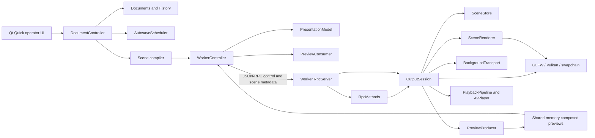

# Architecture and implementation audit

Audited 2026-10-29 against `1b54bdb` plus the SceneStore sharing change and the
6.18a2 `PreviewProducer` extraction described below. This is a source audit of
completed tasks, with current test results in
[PROGRESS.md](../PROGRESS.md). [PLAN.md](../PLAN.md) defines the intended design;
the [M6 review](M6-code-review.md) records the original findings, whose source
line numbers and descriptions are historical.

## Ownership and dependencies

These boxes are responsibilities, not all separate classes. Preview production
graduated into `PreviewProducer` (task 6.18a2) and the background media into
`BackgroundTransport` (task 6.18b1), both beside `SceneStore`, task 6.18b2 moved
the bench/diagnostic drivers into their own `openshow-worker-dev` executable,
task 6.19a1 moved the frontend's transport into `RpcClient`: the socket, the
framing, the reply ledger, the send bounds and the write-stall deadline, task
6.19a2 moved the frontend's pictures into `PreviewConsumer`: the shm mapping and
the mirror, off-air and thumbnail frames copied out of it, task 6.19a3 moved
the acknowledged output model into `PresentationModel`: the revision mirror, the
latest-go rule, the clear derivation and the restore snapshot, and task 6.19a4
split the worker side the same way — `RpcServer` is the connection (accept,
framed read, hello gate, bounded queue and deadline, drain, shutdown) and
`RpcMethods` is the meaning of a request (the method table and the
status/notification encoders). What shares `WorkerController` now is the process
supervisor and its QML facade, which is the division the plan intends; the
remaining planned split is 6.19b, the document adapters and the QML components.

| Boundary | Implementation and evidence | Assessment |
|---|---|---|
| Editable documents and history | `src/domain/{documents,history,storage}.cpp`; Qt adapters in `src/ui/DocumentController.cpp`; `domain_tests`, `document_controller_tests` | Matches. The frontend owns editable state and package writes; history has one observed Documents and bounded snapshots. |
| Immutable render scenes | `src/scene/{scene,demo}.cpp`, `scene_tests` | Matches. Compilation resolves styles, geometry, item order and asset paths; the worker validates scene JSON. The scene library currently depends on domain types/compiler code, but neither uses Qt or GPU APIs. |
| Process separation | `src/worker/CMakeLists.txt`, `worker_is_qt_free`, headless preset | Matches. GLFW/Vulkan/Skia/FFmpeg/PipeWire stay in the worker. Qt Quick, process supervision and document adapters stay in the frontend. |
| RPC | `src/protocol`, `src/worker/rpc/{RpcServer.cpp,RpcMethods.cpp,OutboundQueue.h}`, `src/ui/{RpcClient,WorkerController,PreviewConsumer,PresentationModel}.cpp`; protocol/limits/transport/controller tests; prepare-time file work in `session/PrepareExecutor.{h,cpp}` | Matches the bounded metadata transport. Since **6.19a1** the frontend half has its own class: `RpcClient` owns the socket, the framing, the ledger of requests the worker owes, the size/backlog/in-flight refusals and the 2 s no-byte deadline, and interprets no result — a reply returns with its request's method name, connection generation and the caller's intent record, which is R3's rule kept in one place (`WorkerController::onRpcReply` decides meaning). Since **6.19a3** the scene operations the facade sends are decided by `PresentationModel`, which holds no transport of its own and reaches the ledger only through the injected callbacks. Since **6.19a4** the worker half is split the same way: `RpcServer` is the connection (accept, framed read, hello gate, bounded queue and progress-measured write deadline, drain, deferred-answer bag, shutdown) and `RpcMethods` is the method table and the status/notification encoders, answering through an injected sink so the prepare executor never learns a socket exists; only the connection can end a session. Worker socket writes are nonblocking; since 6.9a dispatch schedules still decodes and media probes onto the bounded prepare executor and answers each request from its completion (self-piped wake, ids correlate), so a cold file delays no other command. |
| Media transport | `src/worker/session/BackgroundTransport.{h,cpp}` over `playback/{PlaybackPipeline,AvPlayer}`; `background_transport_tests` plus the live `background_media_tests` | Matches since **6.18b1** (2026-10-29). The transport owns the background pipeline and its feeder, the standalone track and its swap, the video seam's two bounded slots and their leases, the newest-wins intent slots, the typed faults and the media status mirror; R6's quiesce boundary and the render-thread-owns-the-transport rule are stated in its header. Since **6.9b** (2026-10-30) it also owns the one primed background: `primeVideo` opens a prepared clip's file half on the prepare executor and parks it as the single prime, the render thread attaches that prime's GPU half at the frame boundary (or opens cold), and a superseded prime is closed on the thread that made it. The session keeps the loop's wake gate and the frame's present/lease calls, delegates the RPC verbs, and reads the mirror in `status()`. |

| Requested versus presented state | `src/worker/session/SceneStore.{h,cpp}`, `scene_store_tests`, `output_status_tests` | Matches. Decide captures commands together; landed state is distinct from published state. OutputSession reports the store's published state after successful presentation. |
| Composition and text | `src/worker/render/{SceneRenderer,SceneText,Layer}.{h,cpp}`; scene/frame/Unicode/pixel tests | Matches the shared worker text renderer, public Skia/ICU integration and direct audience composition. Since **6.9b** the layout cache belongs to each `SceneRenderer` — a companion borrows the engine's fonts and shaping, never the audience's four slots, its LRU clock or its miss counter (R16) — and a prepare shapes into the production renderer's own cache. Layer-control semantics have the discrepancy below. |
| Video and audio ownership | `src/worker/{media,playback}`, `src/worker/render/YuvGpu.cpp`; GPU/decode/queue/control/mix/sync tests | Matches bounded queues, displayed-image leases, generation checks and independent audio controls. Since **6.9b** a prepared clip's demux/decode half opens on the prepare executor (`PlaybackPipeline::openFile`) and the render thread's part is the Ganesh attach (`attachGpu`); a clip nobody primed still opens wholly on the render loop. |
| Previews | `src/worker/session/PreviewProducer.{h,cpp}` over `src/worker/preview/PreviewStream.cpp`; the consumer is `src/ui/PreviewConsumer.{h,cpp}` (task 6.19a2), read through `WorkerController`; `preview_producer_tests` plus ownership/selection/budget tests | Matches. The producer owns the stream lifecycle, target arbitration, generation gates, thumbnail queue and budget policy; the session hands in frames and wakes the loop. The consumer owns the mapping, its own two ask generations, the asked/wanted dedupe, the byte-bounded thumbnail LRU and the stand-down re-issues, and asks only through the transport its host injects. Shared memory with exact stream/sequence release; output and audience mirror use the same captured frame; edit selection and thumbnails deliberately render separate scenes. Readback is synchronous. |
| Persistence | `src/domain/storage.cpp`, `src/ui/AutosaveScheduler.cpp`; domain/controller tests | Matches durable staged package writes, asset adoption and coalesced background autosave. Explicit save/load and decision waits remain synchronous. |
| Demo isolation and dependencies | `render/TestScene.cpp`, `cmake/OpenShowSkia.cmake`, `scripts/build-skia.sh`; production/pixel/public-API guards | Production starts black and uses SceneRenderer without a demo builder. Since 6.18b2 the demo scene and the diagnostic drivers compile only into `openshow-worker-dev`; the product binary cannot reach them. Skia is a pinned submodule with public application includes and compatible ICU. |

## Open differences from the plan

These do not reopen every historical milestone. They limit what its DONE status
proves and must be closed or explicitly accepted before M6/M7 acceptance.

| Difference observed in source | Consequence | Follow-up |
|---|---|---|
| **Closed by 6.9b** (2026-10-30) for the prepared path: `BackgroundTransport::primeVideo` opens a prepared clip on the prepare executor, `SceneRenderer::prewarmLayouts` shapes into the production renderer's own layout cache, and `preloadScene()` decodes a blur background's backdrop — all before go, all off the frame loop. What remains is the miss path: an unprimed video still opens on the render thread, `SceneItemsLayer::layoutFor()` still shapes a layout it was never given, and `SceneImageCache::backdropFor()` still builds a missing backdrop synchronously. | A primed scene's frame boundary costs no file work (measured: present→air ~15 ms with a 700 ms scripted open, warm p95 ~9 ms); a scene no prepare primed can still miss a frame deadline, which is the fallback's honest cost rather than a hidden one — the trio `status.scene.images` reports (`drawDecodes`, `drawBackdrops`, `layoutBuilds`) counts exactly those. | **7.2/7.4** soak the miss path against real media; keep it measured, do not re-describe the first blur build as outside the frame loop. |
| Production `ImageLayer::draw()` returns when a scene is active. `SceneItemsLayer` draws both text and foreground images in authored order under `LayerId::kWords`. | The `images` toggle does not hide authored images; `words` hides both. Splitting the item stack by type would also change overlap order. | **6.20** must resolve mixed-item ordering versus independent image/word controls with explicit behavior and regression coverage. This audit preserves current pixels. |
| `DocumentController::save()` waits for autosave quiescence and calls `saveServiceAndAdopt()` inline; load and quit also drain synchronously. | 6.14b proves background **autosave**, not that all persistence is off the UI thread. | **6.19b** save coordination; **6.20** records remaining responsiveness limits. |
| Preview rendering/readback runs on the render thread after output; its budget defers future attempts after an overrun (now inside `PreviewProducer::fillPreviewSlot`). | It bounds average preview work and drops owned slots, but cannot prevent one expensive readback delaying the next audience frame. | Extraction done (**6.18a2**, 2026-10-29) without changing the policy. **6.9b** (2026-10-30) measured the loop THROUGH a slow off-loop open instead of assuming it: the audience's presented frames advanced with a 50 ms worst gap while a scripted 700 ms open ran on the executor. **7.2/7.4** still owe one readback's worst-frame impact. |
| SceneImageCache retains pinned resources even above its 192 MiB eviction budget. | The budget bounds evictable decoded data, not total process/GPU memory; pinned excess is reported. | **7.2/7.4** resource accounting and service soak. Do not describe it as a hard total-memory cap. |
| Missing foreground image errors are logged in `preloadScene()`; the acknowledged media error lane remains background/transport focused. | A missing foreground box can disappear without an operator-facing per-item error. | **6.20** failure-reporting closure (R18); keep a focused task if further implementation is needed. |
| The 6.18a2 extraction landed 2026-10-29: `PreviewProducer` is built (`openshow-worker-preview-producer`), used by OutputSession through a thin delegating seam, and pinned headless by `preview_producer_tests`. The 6.18b1 extraction landed the same day: `BackgroundTransport` (`openshow-worker-session-transport`) owns the background media and its status mirror. The 6.18b2 split landed the same day: the bench/diagnostic drivers and `render/TestScene.cpp` moved out of worker main into the `openshow-worker-dev` executable, leaving the product binary socket-mode only. The 6.19a1 extraction landed 2026-10-30: `RpcClient` (`src/ui/RpcClient.{h,cpp}`, in `openshow-ui-core`) owns the frontend socket, framing, reply ledger, send bounds and write-stall deadline, driven by an unchanged `worker_controller_tests`. The 6.19a2 extraction landed the same day: `PreviewConsumer` (`src/ui/PreviewConsumer.{h,cpp}`, same target) owns the frontend's shm mapping and the mirror/off-air/thumbnail frames, asking through injected callbacks and reading only its own replies, with `scene.prepare`'s intent shared through `src/ui/SceneAsk.h`. The 6.19a3 extraction landed the same day: `PresentationModel` (`src/ui/PresentationModel.{h,cpp}`, same target) owns the frontend's acknowledged output model — the revision mirror, the latest-go rule, the pending logical presentation the clears compose against, the restore snapshot and the asset-path adoption — with the facade's six scene properties and its go/clear/restore/adopt invokables forwarding unchanged. The 6.19a4 split landed the same day, closing 6.19a: `RpcMethods` (`src/worker/rpc/RpcMethods.{h,cpp}`, compiled into the worker binary) owns the method table and the status/notification encoders, and `RpcServer` keeps only the connection — and `WorkerController` keeps the supervisor and the QML facade, which is the planned division. | The remaining planned responsibility boundary is unfinished. | **6.19b**. |
| Stable display identity, destination-removal disabling and complete restart/device recovery are not complete. | Historical display tests and successful launch/shutdown do not establish M7 failure recovery. | **7.1a–c**, physical Wayland/X11 and projector acceptance. |

## Contracts to retain during optimization

- `SceneStore` owns prepared IDs and desired/landed/published output state.
  Prepared scenes are immutable shared instances; a pin survives store eviction.
  The session acquires its mutex before the store mutex, never the reverse.
- `SceneFrame` captures one audience moment. Drawing another target does not
  advance a transition or publish a revision. Publication means successful
  submission/presentation to the window system, not proof of physical scanout.
- The audience composition pass creates no per-layer/intermediate render
  target or `saveLayer`. Preview/snapshot targets and cached CPU blur data are
  separate resources, not extra audience composition layers. Source guards
  supplement pixel tests; they are not a timing proof.
- RPC has a 1 MiB encoded JSON payload limit in both directions, a bounded
  outbound queue and 64 frontend in-flight requests. Original assets, decoded
  media and audio buffers never travel in RPC. Composed preview pixels use
  shared memory; ready/release messages carry metadata.
- Since **6.19a1** the frontend half of those bounds is `RpcClient`, and the
  rule it enforces is the one R3 was about: a reply is delivered to the request
  its id names, on the connection generation that request was written on, and
  with the intent that request's sender attached — nothing in the frontend
  dispatches on result shape, so a burst of prepares cannot misattribute a
  payload or fire a stale auto-present. A message that would exceed the payload
  limit, the 4 MiB backlog or the 64-request ledger is refused locally, with the
  reason and without consuming an id; the connection is ended only when the peer
  has taken not one byte for 2 s, which is a measurement of progress and never
  of queue depth, so a worker that is merely slow keeps its session (R11).
- Since **6.19a2** the frontend's pictures are `PreviewConsumer`, and the rule it
  owns is the one R16 was about: a frame is painted only when it belongs to the
  stream this client mapped and answers the newest ask that target made, so a
  late edit frame or a scrolled-past thumbnail is released like any other slot
  and never reaches a canvas. What the UI *wants* is kept separate from what the
  socket *carried*, which is why a cold start, a stream restart and a worker that
  stood a target down on its own each end with the picture rather than a
  placeholder; the thumbnail cache is bounded by count and by decoded bytes. It
  sends through the transport its host injects and applies the same scene budget
  a present passes, so authoring-side refusal stays one rule (R11), and it
  interprets no reply except the acks its own asks expect (R5).
- Since **6.19a3** the acknowledged output model is `PresentationModel`, and the
  truth it holds is the one R3 and R5 were about: a QML scene property reads a
  single owner, so an indicator cannot light from a request that was refused and
  a clear cannot compose against a payload the operator has already replaced.
  The revision mirror records only payloads this session sent, the newest go is
  tracked separately from the store's counters so a late ack for a superseded
  go cannot move the audience backwards, and a restore keeps its
  content until a status answer confirms the restored revision is actually on
  air. It sends nothing itself — its host injects the live gate, the request
  sender, the prepare-intent handle, the visit over pending prepares and the
  status line — and it reads only the prepare ack and the `scene` block of
  `output.status`, never the shape of any other result (R5).
- Since **6.19a4** the worker answers requests through `RpcMethods`, and the
  division keeps the two rules the connection and the table were each trusted
  with: only `RpcServer` can end a session — a method is refused, never
  punished, and an unknown name is answered rather than dropped — while the
  table owns every argument width, range check and refusal text before a
  session operation is called, so an argument nobody sent still cannot move the
  audience at the new seam (R11). Operation names, error codes and result
  shapes remain the shared typed definitions in `openshow/protocol`: the split
  could not add vocabulary for the frontend and server to drift over (R3). The
  deferred `scene.prepare` ack crosses the seam as a shaped frame through an
  injected sink, so the prepare executor thread stays as socket-ignorant as the
  table that calls it (R10).
- Prepare-time file work (task 6.9a) runs on `PrepareExecutor`: one worker
  thread, at most `kMaxQueued` accepted jobs including the running one,
  cooperative cancellation checked between images, completion fired exactly
  once per accepted job, and `stop()` retiring everything before anything
  the work touches is torn down. The store revision is synchronous truth;
  the `scene.prepare` ack is deferred to the completion and may pass later
  replies — ids correlate (6.3a). The session takes the executor's mutex
  only leaf-side (`queued()`); the executor takes none of the session's.
- A prepared scene's primed work is paid on that executor and consumed only at
  the frame boundary (task 6.9b). `PlaybackPipeline` splits in two: `openFile`
  (probe, format, decoders — any thread, no Ganesh) and `attachGpu` (the frame
  uploader and its ring — render thread only, like every other surface).
  `BackgroundTransport` holds AT MOST ONE primed transport, keyed by path
  under its own leaf mutex; `applyBackground` adopts it when the background's
  identity matches and pays a cold open when it does not. Whoever retires a
  prime closes it on the thread that made it, never on the render loop, and
  `shutdown()` retires the prime before anything it touches. Text layout and
  blur backdrop follow the same rule with their own owners: the layout cache
  belongs to the `SceneRenderer` whose draw reads it — never to the shared
  engine, so a companion cannot evict the audience's layouts (R16) — and the
  prepare path is the only prewarmer of either.
- The live preview transport uses three slots, normally 640×360 at up to
  15 fps when content changes; never overwrite an unreleased slot. Selected
  scenes and thumbnail batches have their own bounded requests and identity.
  `PreviewProducer` owns that stream and its targets (task 6.18a2): frames in,
  slots out — it composes, captures and credits no frame of its own. The
  session takes the producer's mutex after its own, the producer never wakes
  GLFW, and its `pin`/wake calls belong to the caller.
- Native audio decoding feeds bounded rings; the mixer feeds one PipeWire
  stream per AvPlayer. Background-video and standalone transports have
  independent lifetimes, so production can own two AvPlayers/streams. This
  differs from the original single-stream wording: **6.20** must explicitly
  accept that design or restore a shared output mixer. PipeWire callbacks must
  not perform file/RPC/preview work.

## Optimization made during this audit

SceneStore previously stored Scene values, copied one at each `pin()`, and
maintained a separate copy/cache for frame capture. It now copies once on
prepare, outside its lock, and stores `shared_ptr<const Scene>`. Pins, iteration
and frame snapshots use that same instance. This removes repeated deep copies
and the capture cache, and allows selected previews of the same prepared
revision to hit the renderer's pointer-keyed layout cache. Separate prepared
revisions remain separate instances even when their values are equal.

`scene_store_tests` checks shared identity across repeated pins and capture,
isolation from later edits to the caller's Scene, and survival after eviction.
Existing publication, cap, transition and concurrent-command checks remain.
No performance percentage is claimed without a benchmark.
