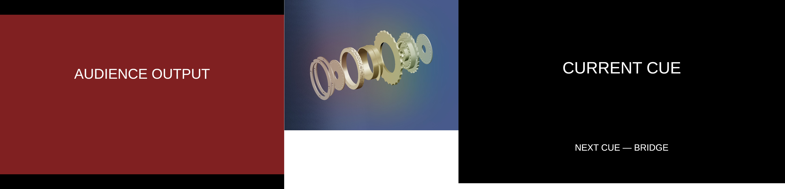

# Stage HDMI: first delivered slice (2026-11-22)

This is the evidence record for the stage delivery plan's rendering checkpoint
(`PLAN.md` → **Stage HDMI delivery plan**). It is not the complete operator
delivery checkpoint: the NDI path, X11, hotplug-under-load and the full timing
matrix remain open.

## What was delivered

- A second worker-owned presentation window, created only by an explicit
  `stage.configure` naming an attached display identity that is not the
  audience's.
- One shared Vulkan device and Ganesh context; each target owns its window,
  `VkSurfaceKHR`, swapchain and companion `SceneRenderer` (its own layout and
  image caches; the audience's layouts cannot be evicted by stage churn).
- Process-owned GLFW lifetime. Closing the stage or the audience window no
  longer terminates GLFW for the other; termination is once, by the session
  owner, after every window is gone.
- Current cue in the stage profile's box (default `160,120,1600,560`) and the
  next cue in a separate v1 slot (`160,740,1600,260`) at 55% of its resolved
  stage style. Overlap with a custom current box is reported, not moved.
- `stage.output.v1` / protocol minor 23: `stage.configure`, `stage.prepare`,
  `stage.present`, `stage.clear`; `output.status.stage` reports enabled /
  active / lost, monitor identity and extent, presented bundle revision and
  generation, next/overlap, frames, failures and the last error.
- Display identity and inventory generation (`output.displays` rows carry
  `identity`, `connectionGeneration`, `x`, `y`); stage selections are
  validated by identity, not by a numeric index. A removal clears stage
  enablement and never falls back to another panel.
- Frontend: the Stage column is activatable only on a worker naming
  `stage.output.v1`; Apply sends the whole stage configuration atomically.
  `ShowPage` compiles the current + immediate next cue on the Stage role; the
  bundle is presented only after that cue is the acknowledged LIVE cue.
  Clear All clears current/next on the stage; Restore re-files the retained
  bundle. A document/order edit while that cue is live re-files the bundle
  with the retained CURRENT scene passed through unchanged and only the next
  region recompiled; deleting the live entry keeps its current words and
  empties next.

## Physical environment

| Item | Value |
|---|---|
| Session | Wayland (KWin), `XDG_SESSION_TYPE=wayland`, `WAYLAND_DISPLAY=wayland-1` |
| GPU / driver | AMD Radeon 890M Graphics (RADV STRIX1), Mesa 26.2.6, Vulkan 1.4 |
| Displays | `[0] eDP-1` 2256x1504@60 scale 2.0; `[1] DP-9` 1024x768@60 scale 1.0; `[2] DP-10` 1920x1080@60 scale 1.0 |
| Audience in capture | fullscreen on DP-9 semantics are covered by `stage_output_tests`; the capture run used monitor 0 for audience |
| Stage | fullscreen on DP-10, framebuffer/swapchain 1920x1080, 2 swapchain images, FIFO |
| Present queue | graphics queue 0 presents the audience and stage surfaces; uploads on queue 1 |
| Measured stage wait | worst present 3.642 ms, worst acquire 0.028 ms over the `stage_output_tests` run |
| Retreat | stage swapchain retirement uses a queue-scoped idle, never `vkDeviceWaitIdle`; enable/disable and resize only |

## Capture

The capture is the whole 9232x2228 virtual desktop. Left: audience scene
(red background, "AUDIENCE OUTPUT"). Right: stage target on DP-10 (black
clear, "CURRENT CUE" in the stage box, "NEXT CUE — BRIDGE" below it in the next
slot). The middle panel is the untouched second display, which demonstrates
that no fallback window was created on it.

## Verification actually run

- `stage_tests`: display identity/ordinals, inventory comparison, next-overlay
  transform and overlap policy, headless.
- `stage_output_tests` (real worker, display label): stale inventory refused,
  audience collision refused, active only after present, current/next bundle
  presented on the stage with no audience revision/monitor move, Clear All
  stage half, invalid scene refused, disable leaves the audience alive, and
  collision refused in the other direction after the audience moves.
- `document_controller_tests` stage-bundle fixture: current cue on the Stage
  role, next row's cue in the next slot at 55%, last cue has no next region.
- `output_layers_ui_tests`: capability-gated Stage activation, next-cell
  legality, Notes refusal, saved identity reselection and Apply sending the
  enable + route + layer mask.
- Existing audience/preview/media display journeys (production output, live
  fade, output status, RPC lifecycle/limits/transport) re-run green.
- Headless preset and source guards: see the run recorded in `PROGRESS.md` at
  the time of this slice.

## Open physical checks

- X11 session (not available on this machine during the run).
- Physical unplug/replug during a live service, and identical-name panels.
- Stage close by the operator under a running service.
- A stage raster/pixel fixture independent of the compositor's own draw.
- Mixed-refresh timing matrix, 10-minute audience-vs-stage timing comparison,
  30-minute enable/disable soak, queue/cache/GPU byte peaks.
- UI keyboard/screen-reader row+column sweep and 100/150/200% scales for the
  new Stage activation control.

Offscreen or fake-peer success is not a substitute for these.